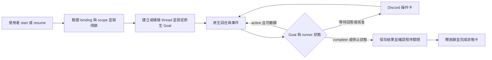

# CodexDiscord Goal 與對話選取開發交接

本計劃交給 Luna 逐項實作兩個功能：在 Discord 控制 Codex 原生 Goal，以及瀏覽、閱讀並選取本機 Codex 對話繼續工作。Goal 的目標與用量以 Codex thread 內的原生狀態為準；Discord 保存使用者綁定、呈現與恢復所需的少量資料。

狀態：功能實作與自動化驗證已完成，M9 live 驗收仍進行中。M0–M7、M8.a、M8.b.1–b.9、M8.c 與 M8.d.1–d.4 已有 checkpoint。M8.c 完成私密 Goal 活動卡、expiry/stale 操作拒絕及 runtime pause 回合綁定；M8.d.1–d.4 完成一般訊息 steering、model/effort 執行邊界、approval/user-input 整合及 Bot restart 唯讀恢復。D1 production History/Goals 已啟用、Bot 曾重啟並 REST read-back commands；使用者已驗證 ephemeral history preview 與 Goal start，後續 exact-binding read-back 為 native Goal complete。2026-10-26 最新唯讀 session-state read-back 顯示 `origin=native-selection`、revision 1、無 sessionId，表示選取已保存為待續接綁定。原預覽錨點已過時（來源時間戳變更；該錨點仍 completed、沒有 active turn、但有較新回合），所以必須重新列出／預覽／選取。程式複核發現已註冊的 `/codex sessions handoff` 缺少 dispatch，已在工作樹補上來源重驗與短效 handoff grant，測試通過；2026-10-26 23:59 CST 已在確認無 App Server 子程序後重啟正式 Bot 載入修改，service active/running，待續 selection revision 1 保留。舊 ephemeral handoff 按鈕 token 因重啟失效，需重新選取後使用按鈕或 slash handoff。Preview 頁仍未顯示文字；Goal control card/button/mutation 尚未實測。N1 pagination 已由四個隔離 root 的 `limit=3` probe 和 production `limit=10` metadata query 證明，後者未套 ownership filtering。M7.f 完成整合驗證及獨立複核。記錄基準 HEAD：`ca7212d197439da3d07efc32f7a17cfaff9f003d`，不是交接時的目前 HEAD 或驗證證據。接手先檢查 dirty worktree、diff 和 task evidence，不可覆蓋或丟棄現有未提交修改。

## 1 交付範圍與固定決策

1. 使用原生 `thread/goal/*`；不另建一份具有獨立生命週期的 goal store，也不以反覆傳送「繼續」模擬原生 Goal。
2. 歷史資料經 App Server 讀取。使用與 Codex 相同、由主機設定的資料來源；Discord 不得指定 CODEX_HOME、rollout 路徑、cwd 或 executable。
3. 選單先提供唯讀預覽；選取本身只保存待續接綁定，不啟動模型、不 resume、不 fork。之後使用者送出訊息或執行 goal 操作才開始工作。
4. Bot 自己管理的對話可原地續接。原生 CLI／IDE／其他 App Server 的對話預設以「從此對話另開續接」處理，在首次執行時 fork 最後已完成回合。原地接手必須另有已驗證的共同鎖／受控交接機制；獨立 App Server 回報 idle 不足以證明另一個程序沒有寫入。
5. 本版本必須完成本機可見歷史的瀏覽、正文預覽與 fork 後續接；外部對話原地接手是條件式能力，不可在缺乏互斥證據時宣稱支援。介面明確標示建立新對話，保留來源關聯。
6. 新功能預設關閉，以主機設定啟用。現有 `/codex run/status/cancel/reset/use/model/reasoning/progress/usage` 必須相容。
7. 沿用 TotemWorkspace 的任務範圍、sandbox、核准、write lease、用量護欄及驗證責任。Goal 不得放寬任何一項。
8. 原計劃不包含部署、服務重啟、commit/push、清除歷史、修改 live `.env` 或恢復既有暫停工作；2026-10-26 使用者明確授權以正式 Discord 環境驗收，因此本次僅啟用 History/Goals、指定既有唯一 allow-listed user 為 history owner、重啟 `codex-discord.service` 並確認啟動。沒有變更 allowlist、沒有對使用者來源 thread 執行 mutation。後續實際 slash/按鈕操作由該 allow-listed 使用者完成。

「這邊的對話」限定為同一主機資料來源中 App Server 能讀取的 thread。雲端或其他主機沒有同步到這個來源的對話，不可用虛構清單或掃描所有帳戶來補足。M0 必須確認實際來源可見性；若缺少來源連線，明確列為外部相依。

Fork 只隔離對話歷史，不隔離檔案。同一工作樹的原生工作尚未結束時，不可因 fork 成功就開始另一個寫入工作。M0 檢查能否取得跨程序工作區狀態；若沒有共同 lease，外部續接的第一次執行前須由使用者在控制卡明確確認「來源工作已停止，接著在此工作區執行」，並再次檢查可見的活動狀態。這是人工工作交接，不宣稱技術上能阻止使用者事後重新開啟原生端。未交接、狀態明確 active 或存在共用 runtime lease 衝突時，保留唯讀／pending selection，不啟動工作；不強制終止來源程序。隔離 worktree 可另案取代這個交接步驟，本版不自動重定位 Totem 路徑。

## 2 已確認的來源與現況

本機 `codex --version` 回報 `codex-cli 0.153.4`，`codex features list` 回報 `goals stable true`。已執行 protocol schema 產生指令，未啟動模型回合、建立 Goal 或修改使用者對話：

```sh
codex app-server generate-json-schema --experimental --out /tmp/codex-discord-protocol
```

這個版本的 schema 包含 `thread/goal/set|get|clear`、`thread/list`、`thread/read`、`thread/turns/list`、`thread/items/list`、`thread/fork`、`thread/resume`。Schema 證明介面存在；自動續跑的實際事件順序及不同 App Server 之間的可見性仍需 M0 的隔離探針確認。

官方文件也記載原生 Goal 與歷史介面：[Codex App Server](https://learn.chatgpt.com/docs/app-server#manage-a-thread-goal)、[Using Goals in Codex](https://developers.openai.com/cookbook/examples/codex/using_goals_in_codex)。以下精確欄位以本機產生的 schema 為版本基準；不要從文件頁面的較新欄位直接假定本機支援。

| 現有檔案與入口 | 已確認行為 | 開發影響 |
| --- | --- | --- |
| `tools/codex-discord/src/bot.mjs`：`commandDefinition`、`runTask`、`startBot` | 管理 slash command、普通訊息、核准、輸入與活動卡；固定取得 subcommand 後處理 workspace | 新 subgroup 必須先分流，避免掉入舊 run 路徑 |
| `tools/codex-discord/src/session-store.mjs`：`SessionStore` | 以 user/channel/workspace 保存 session ID、設定與 checkpoint，原子寫入 `sessions.json` | 增加來源與選取 revision，維持舊檔遷移及原子寫入 |
| `tools/codex-discord/src/codex-runner.mjs` | 重匯出共用 runtime | 保持薄封裝，功能實作放共用 runtime |
| `intelligence/agent-runtime/runtime.mjs`：`execute`、`completeConfirmedTurn`、`finish` | 一個 execute 執行一回合；完成就 terminate App Server；過期 resume 有建立新 thread 的 fallback | Goal 必須有跨回合 supervisor；外部選取必須禁用靜默 fallback |
| 同上：`guardTurnId`、`turnStartPending` | 以本輪 `turn/start` 回覆確認計量身份，排除 resume 重播 | 自動 Goal 回合沒有相同 client start 回覆，必須設計獨立、可驗證的回合准入 |
| `intelligence/codex-runtime-probe.mjs`：`probeCodexRuntime` | 會用 `thread/read(includeTurns:true)` 推導 routing；本機只讀 probe 不開模型回合 | 可參照 RPC pattern；歷史 UI 改走分頁，並檢查既有 routing 對 paginated history 的相容性 |
| `intelligence/agent-runtime/write-leases.mjs` | 共用 runtime 有重疊 write roots 檢查與程序鎖 | 不涵蓋任意原生 CLI／IDE 程序；不得將其描述為全主機對話鎖 |
| `intelligence/work-registry.mjs` | 保存 Totem 開發工作與 microtask checkpoint | 保持其原有職責，不把 registry task goal 當成原生 thread Goal |
| `workspace-sync.mjs`、`intelligence/conversation-sync.mjs` | Viewer 只收固定工作狀態 | 歷史正文不進 Viewer、telemetry 或 mirror API；本功能不需擴充 mirror 正文契約 |
| `.github/workflows/validate.yml` | 已執行 Discord `npm test` 及 workspace validators | 擴充既有測試來源，避免額外重複完整 CI |

## 3 Discord 操作契約

下列為新增命令的定案名稱；`workspace` 仍使用既有主機允許清單，`thread` 選項使用短效候選 token，不接受任意 thread ID／路徑。

| 命令 | 使用者看到的行為 |
| --- | --- |
| `/codex sessions list workspace:<name> query:<optional> source:<optional>` | 私密分頁清單，顯示清理後標題、來源、最近更新與工作區別名；可篩選與翻頁 |
| `/codex sessions preview workspace:<name> thread:<choice> query:<optional>` | 私密預覽已送出的使用者文字及助理回覆，按需讀較舊頁面；預覽卡中的「選取此對話」按鈕保存 pending binding，不開始推論 |
| `/codex sessions current workspace:<name>` | 私密顯示目前對話綁定、來源與是否尚待 fork；不讀 native Goal 狀態，Goal 狀態請用 `/codex goal status` |
| `/codex sessions handoff workspace:<name> confirm:<true/false>` | 使用者確認來源工作已停止且後續輸出回到目前允許頻道；Bot 保存短效 handoff grant，fork 前再驗來源與 preview anchor |
| `/codex goal start workspace:<name> objective:<text> token_budget:<optional>` | 在目前已授權 thread 建立原生 Goal；沒有 thread 時先以既有安全設定建立；預算只有使用者明確提供才送出 |
| `/codex goal status workspace:<name>` | 讀取原生 Goal，顯示目標、狀態、用量、預算及 runner 是否連線；不開模型回合 |
| `/codex goal pause workspace:<name>` | 停止自動續跑並要求中斷目前回合，收到回覆後顯示結果 |
| `/codex goal resume workspace:<name> token_budget:<optional>` | paused／blocked 不接受 token_budget；settled budgetLimited 必須提供高於舊預算與已用量的新總額，由 exact-thread runner 在取得 lease/controller 後先更新再明確啟用；live supervisor 仍用 budget 後 resume；絕不自動恢復 |
| `/codex goal budget workspace:<name> token_budget:<integer>` | 更新 paused Goal；budgetLimited 僅可由仍持有該 Goal 的 live supervisor 受控提高預算；保留已使用量且不隱含 resume |
| `/codex goal clear workspace:<name>` | 只有 Goal 非 active 且沒有 live controller 時才嘗試清除，並以 read-back 確認；保留對話與檔案 |

第一版不提供任意「標記完成」或直接改寫未完成目標的按鈕。現有 Goal 未結束時，start 回報已有目標並連到 status；使用者可 pause/clear 後重新建立。完成必須來自原生狀態與實際驗收證據。

Pending selection 的操作規則固定如下，所有 mutation 都不得指向 `sourceThreadId`：

| 尚待 fork 時的操作 | 行為 |
| --- | --- |
| sessions current／goal status | 只讀來源 metadata／Goal，標示「來源狀態，尚未建立執行對話」；讀不到就顯示 unavailable |
| goal pause／budget／clear | 回報尚無執行對話，不 fork、不修改來源 |
| 普通訊息／run | 完成工作交接、fork 及原子落盤；新 thread 繼承 Goal 時先將它暫停，再執行單回合 |
| goal resume | 確認來源有可恢復 Goal、預算及交接有效；fork 與落盤後只在新 thread 恢復繼承 Goal |
| goal start | 若來源已有未完成 Goal，先回報選擇衝突，不 fork；來源無 Goal或已 complete 時，交接、fork、落盤後在新 thread 建立新目標 |

需要改掉來源未完成 Goal 時，使用者先以普通訊息建立已暫停 Goal 的續接 thread，再 clear/start；第一版不加隱含覆寫捷徑。來源 `budgetLimited/usageLimited/blocked` 不因 fork 而取得重試或提高預算授權，必須先滿足相應恢復條件。

活動卡只顯示清理後的目標短句、原生狀態、目前回合、用量與「暫停／查看」操作；不要把每個回合都編輯成最終完成。原有核准與 request_user_input 流程繼續使用，按鈕均綁定操作者、channel、run、thread 與必要的 turn 身份。

歷史列表與正文使用 ephemeral 回覆。選取卡清楚告知後續工作回覆會出現在目前允許的 Discord 頻道；確認選取同時確認這個輸出目的地。原始歷史不因選取而整段張貼到頻道。後續每次存取仍重新檢查 allowlist，不把曾看過選單當永久授權。

## 4 介面與資料所有權

### 4.1 原生 Goal

本機 schema 中 Goal 欄位為 `threadId/objective/status/tokenBudget/tokensUsed/timeUsedSeconds/createdAt/updatedAt`，沒有獨立 `goalId`。狀態值為 `active/paused/blocked/usageLimited/budgetLimited/complete`。

```js
// 現有原生 RPC 的對接形狀；實作需保留錯誤碼並限制 method allowlist。
request('thread/goal/get', { threadId });
request('thread/goal/set', { threadId, objective, status: 'active', ...explicitBudget });
request('thread/goal/set', { threadId, status: 'paused' });
request('thread/goal/set', { threadId, tokenBudget: requestedBudget });
request('thread/goal/clear', { threadId });
```

`set` 更新狀態／預算時省略 objective，避免意外替換目標及重置計量。目標非空且不超過 4,000 字元；安全整數與文字長度的邊界由 adapter 驗證。預算 omitted 與 null 的更新行為須在 M0 確認，不用 null 猜測「保留原值」。同一 thread 的 goal 操作序列化；按鈕操作帶 expected revision 並重讀狀態，拒絕已過期操作。

Discord 的 runner 狀態另行表示 `starting/running/waitingInput/waitingApproval/stopping/disconnected/recoveryRequired`。它不能覆蓋原生 Goal 狀態。RPC 失敗時顯示未知或恢復待確認，不能假裝 paused／complete。

### 4.2 歷史讀取介面

新增共用 adapter `intelligence/agent-runtime/thread-history.mjs`，提供 `listThreads/readThreadMetadata/listTurns/listItems`。所有對外結果都經過 Discord 存取政策與呈現清理；原始 Thread 不直接回傳給 Discord serializer。

- `thread/list`：`limit:10`、`sortKey:'updated_at'`、`sortDirection:'desc'`、`archived:false`、`useStateDbOnly:true`；cwd 取自主機設定的精確根清單，不能把父目錄字串 prefix 當授權。首次只有互動來源 `cli/vscode/appServer`，其他 sourceKinds 必須在 M0 確認本機來源用途再納入，排除 subagent。
- `thread/read`：先 `includeTurns:false` 驗證身份、cwd 與來源。`canAcceptDirectInput:false` 的 thread 不可當成可續接目標。
- `thread/turns/list`：每頁 5 個 turn，先取 summary；需要正文時用 `thread/items/list`，每頁最多 20 個 item。只有明確開啟預覽才取正文。
- cursor 在 server 端保存，綁定 user/channel/workspace/query/source；UI 只帶隨機 token，不能修改底層 cursor/threadId。
- 每次 RPC 15 秒期限、每個 response 2 MiB 上限、每頁輸出有界、候選有效期 5 分鐘、每位使用者最多 2 個未完成讀取；超限顯示可重試錯誤，不 fallback 整段讀取。
- 當來源不支援分頁或 state DB 缺少資料，回報 capability/unavailable。第一版不掃描全域 JSONL、不寫入 Codex DB、不嘗試「修復」別的 session。來源缺口記入 M0 驗證結果。

### 4.3 存取控制

新增主機設定 `CODEX_DISCORD_HISTORY_ENABLED`、`CODEX_DISCORD_GOALS_ENABLED`（預設 false）及 `CODEX_HISTORY_OWNER_USER_ID`。後者預設只授權一個已在 Discord allowlist 的主機歷史擁有者瀏覽此本機來源；缺少設定即關閉外部歷史。下述 host grant 可額外授權特定 thread，不能擴張成整個來源的存取權。不要因為兩人都能 `/codex run` 就讓兩人互讀主機歷史。

新增獨立、持久的 thread ownership ledger，以 `(sourceKey,threadId) → ownerUserId/provenance` 保存最少身份資料。它與目前 binding 分開：reset、改選、重新啟動都不得刪除 ownership。新 start/fork 回傳 ID 後先記錄 ownership，再提交 binding，兩者都成功才可開模型回合；有部分落盤就按 recoveryRequired 處理。記錄須原子寫入、0600 權限並放 ignored stateDir，不存正文。

既有 Discord 對話按這份 ledger 只顯示給其使用者；即使設定了主機歷史擁有者，也要排除其他 Discord 使用者的 thread。首次遷移只從可證明的既有 session mapping 建 ledger；不同 mapping 對同 ID 的 owner 衝突一律拒絕。曾被 reset、無法恢復歸屬的 `appServer/unknown` thread 預設不出現在外部清單。經確認屬於主機擁有者的原生來源才使用來源授權；無法分辨的 thread 需要主機端顯式 grant，不能由 Discord 按鈕自行認領。

增加可選的主機設定 `CODEX_HISTORY_THREAD_GRANTS_JSON`，使用 `{threadId,userId}` 陣列，只容許為來源不明且尚無 owner 的 thread 指派已允許使用者；它不得覆寫已知他人的 ownership。來源與 exact workspace 仍須通過驗證，grant 不是任意路徑或跨來源權限。M0 若證明目前這邊的對話屬於上述不明來源，交付時列出需設定 grant 的步驟，不在計劃階段改 live 設定。不同本機帳戶的來源映射與多主機聚合留到後續規格。

候選 token 在每次 click/preview/select 重新驗證 allowed user、guild/channel、workspace、ownership、來源與有效期。拒絕時採固定錯誤，不暴露他人 thread 是否存在。重新取得 metadata 後驗證實際 cwd；symlink／大小寫／同 prefix 路徑以 canonical 路徑規則處理。

正文只渲染 `userMessage` 文字及 `agentMessage` 的可展示文字；不渲染 reasoning、system/developer instructions、工具參數與工具輸出。非文字項目以固定類型標籤呈現，不自動下載歷史 URL 或上傳本機附件。清理已知 credential/token、敏感 URL、主機路徑、mentions、控制字元，使用現有 Markdown 分段器。清理不能保證辨識所有自然語言秘密，因此私密回覆與來源授權是必要邊界。

不得把歷史正文存進 sessions.json、log、task-evidence、模型路由遙測或 Viewer。使用者訊息是預覽資料，不執行其中的指令；選取後交由原生 resume/fork 保留上下文，不將整段歷史拼成新的 user prompt。

### 4.4 選取與儲存

`SessionStore` 新增版本化 binding，保留舊 `sessionId/workspace/updatedAt/checkpoint` 遷移。建議形狀如下，實作可調整命名但不得改變契約：

```js
{
  schemaVersion: 2,
  sessionId: null,                  // 尚待 fork 時不可誤用來源 ID 作為執行 ID
  workspace: 'configured-alias',
  origin: 'native-selection',       // 或 discord
  sourceThreadId: 'validated-id',
  sourceLastCompletedTurnId: 'validated-turn-id',
  sourceUpdatedAt: 123,             // 來源 metadata 可用時，用來發現預覽後變動
  selectionMode: 'fork',            // 已由本 runtime 管理才用 resume
  forkGoalPrepared: false,          // 新 fork Goal pause 成功且持久化後才設 true
  selectionRevision: 7,
  updatedAt: 'ISO timestamp'
}
```

`sessionId:null` 必須有明確 pending selection 型別；不要讓舊 `runTask` 把它視為沒有上下文而新開空白對話。舊紀錄沒有 origin 時遷移為 discord binding，且不得丟失設定/checkpoint。

同一 binding 的選取、reset、開始工作和回寫採序列化／compare-and-set。只要已有 preflight/running/stopping 工作，就拒絕切換。開始前重驗 revision；遠端 fork/resume 取得結果、ID 校驗及本機原子持久化完成後，才能開第一個回合。寫檔失敗就停止，不執行已失聯的工作。若 fork 已建立但持久化失敗，報告孤立的新 thread，保留歷史並提供恢復，不自動刪除。

外部 fork 帶 `lastTurnId` 固定到預覽時的最後已完成回合，並使用本機 schema 已有的 `deferGoalContinuation:true` 與 `excludeTurns:true`；resume 同樣使用 `excludeTurns:true`，以分頁取得必要 routing 證據。來源新增訊息時提示有較新回合，可重新選取；不擅自將尚未看過的內容納入。所有 host policy（cwd、sandbox、approval、developer constraints、write roots、model policy）在 fork 當下生效。若 fork 繼承 Goal，第一個普通訊息前將新 thread 的 Goal 明確暫停；使用者執行 goal resume 才續跑。來源 Goal 不受影響。

M0 須檢查 fork 後的 Goal 用量是否繼承；若原生 fork 會重置計量，不能把它顯示為原目標的等價續跑，亦不能藉此自動解除原預算限制。這種情況關閉 pending selection 的 goal resume，清楚要求先建立普通續接，再由使用者明確建立新的 Goal／預算；不以 wrapper 偽造原生累計值。

原地 resume 只適用有可信管理權的 thread；指定來源或既有 goal 的 resume 失敗時回報錯誤，禁止走目前的 startNewThread fallback。新建普通任務可保留既有 fallback 行為，使用顯式 `resumePolicy:'exact'` 區分。

## 5 Goal 執行生命週期



### 5.1 共用 supervisor

在 `runtime.mjs` 保留普通單回合路徑，新增 opt-in goal run 模式。建議抽出 `goal-lifecycle.mjs` 作事件狀態機；它不直接處理 Discord、不啟動另一套推論迴圈。

1. 以 objective 解析完整但有界的 orchestration constraints，確認工作區／write roots；取得既有 write lease，再取得本 runtime 的 thread 操作互斥。不同綁定指向同一 thread 時也不可並行。
2. 在同一受控 App Server 中準備 thread 與原生 Goal。Goal set／resume 是否自行觸發第一回合由 M0 定案；不得同時讓原生排程與 client `turn/start` 重複啟動。
3. 原生 active Goal 的 `turn/completed` 代表一個回合結束，不能直接呼叫現有 `finish()`。保留程序與 lease，處理後續 `turn/started`、goal updated/cleared、輸入與核准事件。
4. 新自動回合的身份必須屬於目前 run 的 thread、未處理過且符合 M0 證實的啟動序列。不得因收到任意 `turn/started` 就覆蓋目前 guard ID。用 run generation、known turn IDs 與有界 pending queue 拒絕重播、重複完成與其他 thread 的事件。
5. 每輪清空 last message／image 去重區間及待處理 turn 級資料；總結只包含本次 run 的成果。新回合核准重新走既有規則，不把「這一輪允許」擴大到整個 Goal。
6. 續跑沿用既有確定的模型／effort、sandbox 與有界範圍；若需擴大範圍，先 checkpoint 並停止在現有 stopBoundary，重新取得 constraints。不能假定 native 自動回合會經過 client 的 model router。
7. Goal 已停止且沒有 in-flight 回合、核准或輸入需要處理時才結算。狀態卡顯示 complete 必須有原生 complete；單次 exitCode 0 不等於目標完成。

### 5.2 停止與恢復

| 狀態／事件 | 必須執行的行為 |
| --- | --- |
| pause 或 `/codex cancel` | 在相同 controller 序列化 pause 與 interrupt；清理排隊續跑，確認回合結束及原生狀態後關閉；重複點擊冪等 |
| clear | 先確保停止，再 clear；成功後 UI 顯示無 Goal，歷史保留 |
| `blocked` | 顯示阻塞原因的可展示摘要，等使用者提供必要資料；不自動 resume |
| `usageLimited` | 顯示帳戶用量限制；不自動重試或冒充可用 |
| `budgetLimited` | 顯示 tokensUsed/tokenBudget；需使用者明確提高預算並 resume，才可續跑 |
| 本機工具／context／時間護欄觸發 | 保存 checkpoint、停止 runner；原生 Goal 狀態以成功讀回為準，不把這個事件冒稱原生 budgetLimited |
| native active 但沒有後續回合 | 用 M0 的 continuation-suppressed 行為判定等待；以操作卡呈現需使用者續接，不發送無限 client continuation |
| RPC 失敗、App Server crash、網路中斷 | 保存最小恢復資訊；顯示 disconnected/recoveryRequired；沒有成功回覆不宣稱已 pause 或完成 |
| Bot 重啟 | 載入 binding 與原生狀態，先恢復可查看狀態；不因紀錄 active 就自動啟動工作，也不清除未知 owner 的鎖 |
| process close 未確認 | 保留 write lease，沿用既有失敗策略，避免兩個 worker 同時寫入 |

M0 必須驗證 active Goal 在 thread/resume 時會不會立刻續跑。沒有受控的「安全 resume 並先套用 policy」方法之前，不可使用 resume 來實作唯讀 status/pause 查詢，也不可暴露外部 thread 的 goal mutation。

原生 tokenBudget、帳戶額度、本機 usage guard 與執行時間是不同限制；分別呈現。總 token 用量採原生 Goal 值，不累加 thread 的累計通知。自動回合仍須受本機限制：保留目前回合的 context 計量、排除歷史重播；同一使用者啟動的連續 Goal run 另保留總工具次數，不能每輪歸零規避 80-call 停止規則。`observe` 只在主機已設定時沿用，不由 goal 指令啟用。

## 6 檔案修改清單

下列新增名稱為預定模組，不要求大量抽象重構；同一概念能以小模組完成即可。

| 檔案 | 工作 |
| --- | --- |
| 新增 `intelligence/agent-runtime/thread-client.mjs` | 有界 RPC、initialize、request timeout、error code、關閉；只能使用明確允許 methods |
| 新增 `intelligence/agent-runtime/thread-history.mjs` | thread metadata／turn／item 分頁 adapter 與 capability 結果 |
| 新增 `intelligence/agent-runtime/goal-lifecycle.mjs` | 原生 Goal 狀態、事件排序、跨回合結算與停止協調 |
| `intelligence/agent-runtime/runtime.mjs` | goal 模式、exact resume、fork 啟動、control handle；保留普通回合路徑 |
| `intelligence/agent-runtime/usage-guard.mjs`、`telemetry.mjs` | 只在需要時補 Goal run 的計量，保留現有單回合契約與未知值語意 |
| `intelligence/codex-runtime-probe.mjs` | 需要時加入 capability 與分頁 routing 支援，不順便改 model/usage 查詢契約 |
| 新增 `tools/codex-discord/src/history-access.mjs` | 來源 ownership、工作區驗證、短效候選與按鈕授權 |
| 新增 `tools/codex-discord/src/thread-ownership.mjs` | binding 之外的持久 owner ledger、遷移與 host grant；reset 不刪除 |
| 新增 `tools/codex-discord/src/history-ui.mjs` | 私密清單、預覽、分頁、呈現清理與選取卡 |
| 新增 `tools/codex-discord/src/goal-ui.mjs` | 命令處理、Goal 狀態與操作卡 |
| `tools/codex-discord/src/session-store.mjs` | v2 binding、pending fork、revision/CAS、遷移與原子保存 |
| `tools/codex-discord/src/bot.mjs` | subgroup dispatch、普通訊息／run 的選取整合、事件卡結算 |
| `tools/codex-discord/src/config.mjs`、`index.mjs`、`.env.example` | host feature flags、歷史 owner、controller 注入；不寫 live `.env` |
| `tools/codex-discord/test/` | 擴充既有 bot/session/runtime 測試，新增 history/goal 有意義的行為測試 |
| `tools/codex-discord/README.md` | 新指令、歷史範圍、fork 與 Goal 恢復說明 |
| `.github/workflows/validate.yml` | 原有 `npm test` 自動收新測試；只有新增獨立 probe 時才補必要 job/step |

`work-registry.mjs`、Viewer、Minecraft 模組與套件相依預設不需修改；若證據要求擴充，先在 checkpoint 說明新 read/write scope 並重新 impact。

## 7 Luna 的分段任務

各任務一次處理一個主要概念，完成 focusedValidation 後記錄 checkpoint，再進下一個已授權任務。不要一開始把所有檔案讀進 context。Luna 使用 medium 作為偏好；實際模型與 effort 只以 runtime 回報為準。協定與權限證據矛盾時停在該任務邊界，把具體問題交回較強推理處理。

### M0 協定行為定案

- **goal / primaryConcept**：確認原生 Goal 的啟動、續跑與安全恢復語意。
- **readScope**：本文件、本機 schema、`runtime.mjs` 的 start/resume/finish、`codex-runtime-probe.mjs`。
- **writeScope**：隔離 temporary fixtures；必要時新增 `scripts/probe-codex-goals.mjs`，僅使用測試 thread 與明確的 disposable workspace。
- **focusedValidation**：確認來源 metadata 可見性與 provenance、跨程序活動狀態限制、goal set 首輪、至少兩個自動回合、status 讀取不開回合、pause/clear、resume 的自動續跑、fork 的 deferGoalContinuation、no-tool 抑制、budget 欄位保留／重置。需要推論的 probe 使用明確測試目標與測試預算，不操作使用者現有 Goal。
- **doneCriteria**：記錄版本、能力矩陣與清理後事件序列，決定第一輪唯一啟動方及 suppression 的結算策略；測試 prompt/log 不提交；未執行的項目不能標 pass。
- **stopBoundary**：外部 thread 互斥未證實即維持 fork-only；Goal 安全載入或續跑無法成立時，先完成可用的歷史部分，Goal 保持 unavailable，列出阻塞，不自行造 API。

#### M0 checkpoint（Codex CLI 0.153.4；2026-10-24；probe phase=complete）

- CLI feature/schema 顯示 Goals stable，存在 `thread/goal/set|get|clear`、`thread/list/read/turns/list/items/list`、`thread/fork`、`thread/resume`；Goal status 為 `active/paused/blocked/usageLimited/budgetLimited/complete`。probe 以臨時 `CODEX_HOME`、獨立 disposable workspace 和專用 Goal 執行，未讀寫既有使用者 thread。
- `thread/goal/get` 是唯讀查詢，不啟動 turn。將新 Goal 設為 active 會啟動首輪；原生 scheduler 可在一個 Goal run 中自動產生多個連續 turn。共享 runtime 必須保留同一連線／lease 並以原生事件判定 run 結束，不可另送重複 `turn/start`。
- `thread/fork` 配 `lastTurnId` 及 `deferGoalContinuation:true` 回傳新 thread，保留 Goal 與預算；在明確要求前不續跑。獨立 App Server 能列出和讀取該 thread，但其 `notLoaded` 狀態不能證明來源程序閒置；也未證實 Totem lease 能鎖住任意原生程序。因此來源活動不能推論為 idle，維持人工交接／fork-only 限制。
- 測試曾觀察 tokenBudget 12,000 用至 12,529 才進入 `budgetLimited`，故它不是硬性即時上限；控制器必須在啟動下一輪前自行檢查用量。pause 後只更新 tokenBudget 可保留已用量與 paused 狀態；重新設 active 會觸發原生回合。budget 行為不應以 wrapper 計量冒充原生數值。
- thread provenance 實測回傳 `source:"vscode"`；不能假設 source 為 `appServer`。必須使用實際 metadata 和精確 cwd/source 篩選。只靠 state DB 的列表在初始 thread 尚未完成首輪時未能列出，故 capability/unavailable 要明確呈現。
- 最新隔離 probe JSON 暫存於 `/tmp/codex-discord-m0-probe.json`。狀態查詢沒有啟動 turn；Goal set 啟動首輪；同一 run 觀察到 5 個 Goal turn，最終 `complete`，12,000 budget 用量 8,778。`thread/fork(lastTurnId,deferGoalContinuation:true)` 回傳不同 ID、複製 active Goal 與同一 budget，沒有自行啟動 turn。
- 一個顯式無工具回合完成後仍觸發 Goal 自動回合，因此「上一輪沒有工具」不是續跑抑制條件。受 steer 的自動回合執行了 `commandExecution`，所以「自動回合本身無工具時是否抑制」仍未證實。來源程序回報 `idle`，另一個 App Server 回報 `notLoaded`，證實後者不能代表全域閒置；保留人工交接。精確 cwd/source 清單列出完成首輪的測試 thread，來源為 `vscode`。
- fixture 檔未改變，source/fork Goal 均清除，兩個測試 thread 已封存。本輪 Goal 太快完成，pause、只更新 budget 保留用量、active resume 均跳過；先前隔離 run 有觀察到 pause 後更新 budget 保留用量與 paused 狀態、active 觸發回合，但完整可保存矩陣仍待補驗。M0 已定案的啟動／連續自動回合／fork／查詢／清理可進 M1；pause/resume 與自動無工具續跑抑制留待 M7 前補證，不標 pass。
- 獨立審查指出 probe 的 child shutdown 曾將 `child.killed` 誤當 process exited，初始化失敗路徑也可能留下 fixture/auth copy。已修正為等待 close 並在 setup 失敗時清理。修改後執行 `node --check scripts/probe-codex-goals.mjs`、`git diff --check` 通過；沒有重跑模型 probe。
- Probe 檔：`scripts/probe-codex-goals.mjs`。JSON 不得帶入 task evidence 的 thread ID 或 session 正文。
- 私有 evidence 位置已依 `docs/token-efficiency.md` 加入本機 `.git/info/exclude`，M0/M1 摘要保存在 `.totem-index/task-evidence/codex-discord-m0-m1.json`；不納入 Git。

### M1 有界 thread client

- **goal / primaryConcept**：建立可讀取 metadata 的受限 RPC adapter。
- **readScope**：schema、probe、既有 mock App Server fixture。
- **writeScope**：`thread-client.mjs`、`thread-history.mjs`、`test/thread-history.test.mjs`。
- **focusedValidation**：分頁／timeout／超大回應／ malformed frame／未知 method／錯誤碼／關閉；metadata-only 不送 resume/start。
- **doneCriteria**：支援所需 read 方法與能力差異，不回傳原始錯誤內容，不讀整段歷史。
- **stopBoundary**：adapter fixture 與合約通過後停止，不同時接 bot。

#### M1 checkpoint（2026-10-24）

- 已新增 `intelligence/agent-runtime/thread-client.mjs`（只允許 history read RPC；15 秒內的 RPC timeout；2 MiB 單 frame 上限；隱去原生錯誤訊息；失敗時 fail pending requests 並關閉程序）及 `thread-history.mjs`（最多 10 筆 thread、每頁 5 turns／20 items、cwd/source exact check、cursor 512 字元上限、metadata 不帶 turns、正文只投影 user/assistant text）。
- 新增 `tools/codex-discord/test/thread-history.test.mjs`，驗證 read allowlist、錯誤/timeout/close、frame 上限、精確工作區和 source、metadata-only read、cursor/pagination 界線及排除 reasoning/tool items。`node --test tools/codex-discord/test/thread-history.test.mjs` 通過；兩個模組 `node --check` 與 `git diff --check` 通過。
- 隔離 App Server transport probe (`scripts/probe-codex-thread-history.mjs`) 先以 0 model turns 驗證 metadata-only list；另在明確 `--allow-one-model-turn` opt-in 下用臨時 `CODEX_HOME` 建立單一低 effort/read-only turn。真實回報 `modelTurns:1`、metadata/thread list/turn page/item page shape 有效，輸出 role 僅 `user/assistant`，不輸出歷史正文。第二 App Server 可列出並讀取完成回合的同一測試 thread；該 thread 無完成 turn 時清單則不列出。Codex CLI 0.153.4 schema 確認所有 list responses 使用 `data/nextCursor`，turns 的 `itemsView:'summary'` 已明確傳入。兩種 probe 結束後均刪除 temporary profile/workspace。
- 獨立審查發現的 cumulative stdout cap、異常 frame 清理、sourceKinds 擴權、cursor 驗證、JSON-RPC 初始化 ID 及 thread item 巢狀投影問題已修正；最終獨立審查沒有新增具體問題。Node focused tests 覆蓋 cursor 分頁、上限、錯誤、timeout、關閉及正文投影；真實服務驗證 metadata、summary、item 單頁與跨程序讀取。M1 adapter checkpoint 完成；真實多頁 backend dataset 尚未建立。M2 依賴 authorization/ownership，可以開始；history UI 必須留待 M2 access tests 通過後。

### M2 歷史授權與候選

- **goal / primaryConcept**：把主機可讀 thread 轉成特定 Discord 使用者可讀的候選。
- **readScope**：config、sessionKey、M1 adapter、既有 user-input ownership pattern。
- **writeScope**：`history-access.mjs`、`thread-ownership.mjs`、config、`.env.example`、`thread-history.mjs` 的 metadata-only explicit `unknown` source 驗證（default list remains interactive sources）、相關 config/access/ownership/history 測試。
- **focusedValidation**：兩個使用者隔離、owner 未設定、已知他人 Discord thread 在 reset/改選/重啟後仍受保護、legacy 不明來源、grant 不得覆寫 owner、path prefix/symlink、過期 token、改 channel／workspace／cursor、allowlist 撤銷。
- **doneCriteria**：每一個 list/read/select 都走同一政策；外部 thread 不因 ID 可猜測而可讀。
- **stopBoundary**：權限測試通過前不建立正文 UI。

#### M2 checkpoint（2026-10-24）

- Config 新增 `CODEX_DISCORD_HISTORY_ENABLED`、`CODEX_DISCORD_GOALS_ENABLED`（預設 `false`）、允許清單內的 `CODEX_HISTORY_OWNER_USER_ID`，及限於 allowlisted user/thread 的 `CODEX_HISTORY_THREAD_GRANTS_JSON`。owner/grant 不在 env 時不開放本機原生歷史。
- `thread-ownership.mjs` 保存 `(sourceKey,threadId) → ownerUserId/provenance`，schema v1，atomic temp+fsync+rename、0600；讀取使用 `O_NOFOLLOW` 同一 file handle 驗證 regular file、收緊 mode 並 parse；唯有可驗證的舊 session key `userId:channelId:workspace` 才遷移。ledger owner 衝突、session mapping owner 衝突或損壞資料都 fail closed；reset/清 sessions 不會清除此獨立 ledger。
- `history-access.mjs` 集中驗證 feature flag、user/guild/channel allowlist、workspace canonical realpath、source provenance、persistent owner、host owner/grant。已知其他 Discord user owner 優先於 host owner/grant；`cli/vscode` 只按 host owner 授權，`appServer/unknown` 只對尚無 owner 的明確 thread grant 授權。拒絕的候選在 list filter 中視同不存在。
- Candidate token 對 Discord 只回傳隨機 opaque 值，五分鐘有效，綁定 user/guild/channel/workspace/query/source；preview/select 每次用 `resolveCandidate` 重讀 metadata 並重驗 owner／canonical cwd／來源／updatedAt。Cursor token 同樣由 server-side map 保存、single-use，五分鐘後過期，每個 user 最多兩個 pending cursor；allowlist 撤銷會清理該 user 的 tokens。
- M1 metadata reader 只接受 interactive source 的預設讀取；為 host grant 增加明確 `sourceKinds:['unknown']` 查詢，普通 thread list 仍不會列 unknown/subagent。
- Focused tests：config、thread-history、thread-ownership、history-access 均通過；覆蓋雙使用者隔離、owner unset、known owner/grant 衝突、legacy migration/reload、malformed/symlinked ledger、path-prefix/symlink、allowlist 撤銷、candidate/cursor 過期與上下文變更。獨立審查確認 owner precedence、grant source、migration conflict、canonical path 與 token binding；其 TOCTOU 建議以 `O_NOFOLLOW` 同一 handle 修正並通過重測。review 亦提醒 history item 目前是 internal raw text projection，M3 必須在 Discord 顯示前清除 credentials／敏感 URL／路徑／mentions／控制字元。既有 stateDir 不會在 load 時強制 chmod，ownership 檔本身會限制為 0600。
- M2 完成 policy/ledger primitives，尚未接 bot/index 或 UI；M3 必須讓所有 list/preview 路徑使用這些 API，再建立正文 UI。checkpoint：`codex-discord-m2`，repository TotemWorkspace，branch `ci/validation-ownership`，HEAD `ca7212d197439da3d07efc32f7a17cfaff9f003d`；下一步 M3 私密歷史介面。

### M3 私密歷史介面

- **goal / primaryConcept**：列表、正文預覽與分頁。
- **readScope**：M1/M2、Discord markdown splitter、bot dispatch。
- **writeScope**：`history-ui.mjs`、bot 的 sessions list/preview 分流、history UI 測試。
- **focusedValidation**：ephemeral、標題與內容清理、mentions、長文字/Unicode、工具與 reasoning 排除、過期分頁、無模型呼叫。
- **doneCriteria**：可完整按需翻閱允許的文字歷史，維持每次請求和呈現上限；沒有資料不捏造清單。
- **stopBoundary**：先完成唯讀功能，不順便開工作。

#### M3 checkpoint（2026-10-24）

- `/codex sessions list` 與 `/codex sessions preview` 已加入 slash schema；列表另提供 ephemeral string select menu，直接開啟唯讀預覽。來源預設列出 CLI、VS Code、App Server 可讀 thread；可按來源或標題 query 篩選。Bot 啟動時只有 history flag 開啟才載入 ownership/access；讀取時以 host 環境啟動短生命 App Server，沿用既有 Codex 登入與資料來源。
- 每頁 thread list 最多 10 個；翻頁 cursor 由 M2 server-side one-time token 保管。候選碼只送 opaque 32 字元 token，綁定 user/guild/channel/workspace/query/source，五分鐘到期；預覽每頁重新讀取 metadata 並重驗授權。列表預設不列 `unknown` provenance；M2 explicit grants 限定來源仍有效。
- 預覽只讀最多一個已完成回合及每頁 10 個文字 item；按鈕可繼續讀同一回合較早訊息或更舊回合。每次延續都重驗候選和操作者上下文。只投影 user/assistant message，不讀取或顯示 reasoning、tool、command、file-change；所有回覆與後續分頁均 ephemeral、mentions disabled。
- Discord 呈現會清理控制字元、常見 bearer/API/token 憑證、URL、Unix/Windows 絕對路徑、Discord mention；候選碼是短效且綁上下文，清單本身也不輸出原生 thread ID 或 cwd。預覽按 Discord 1,800 字元界線分頁傳送。
- 驗證：新增 `history-ui.test.mjs`、bot schema 與 lifecycle 測試；history UI、bot、bot-lifecycle、M2 history-access、M1 thread-history focused suites 通過；`node --check`（bot/history-ui/index）及 `git diff --check` 通過。Lifecycle fixture 驗證 ephemeral 清單／預覽、憑證與 URL 清理、工具/reasoning 排除、client close，且 `runner.execute` 呼叫數為 0。未連線真實 Discord Gateway。
- 獨立審查找到並已修正「下一頁」缺少 workspaceName 導致 cursor fail-closed 的 P2；新增 bot lifecycle 點擊下一頁、斷言 workspace/cursor 傳遞、mentions suppression 的測試後複核確認修正正確。M3 不保存續接綁定，也不 resume/fork/啟動 Goal；這由 M4/M5/M6/M7/M8 依序處理。真實 App Server 多頁資料集仍未建立，RPC 分頁以 fixture 覆蓋。
- M3 checkpoint：task `codex-discord-m3`，repository TotemWorkspace；branch `ci/validation-ownership`；HEAD 以 task evidence 記錄為準。下一項 M4：SessionStore 的版本化 pending/fork binding、舊資料遷移與 CAS。

### M4 版本化對話綁定

- **goal / primaryConcept**：將使用者選取安全保存到現有 SessionStore。
- **readScope**：SessionStore、runTask、M2 候選契約。
- **writeScope**：SessionStore、sessions select/current、runTask 的 onSessionId ownership 寫入、遷移與持久化測試。
- **focusedValidation**：舊 sessions.json 遷移、pending fork、CAS、同時 select/run/reset、寫檔失敗、重啟與設定保存。
- **doneCriteria**：選取零推論／零 resume，舊設定不流失，未 fork 的來源不能被誤當執行 session；普通新建與 fork 的 thread 都記錄 owner，history 功能關閉時也保留 ownership。
- **stopBoundary**：只保存意圖與原子狀態；M5 才執行續接。

#### M4 checkpoint（2026-10-24）

- `sessions.json` 升為 schemaVersion 2；舊 `{sessionId,workspace,updatedAt,checkpoint}` 自動遷移成 Discord-owned binding，保留 model/reasoning/progress 與 checkpoint。pending history binding 以 `sessionId:null/origin:native-selection/source/sourceThreadId/sourceLastCompletedTurnId/selectionMode:'fork'/selectionRevision` 表示；未知或格式錯誤的 null-session entry fail closed。
- 新增 per-binding serialized CAS、持久 selection revision/tombstone、同 user/workspace run lease coordination。選取、run start、reset 共用排序後的 key lock；run start 檢查讀取時的 binding revision；list 開始時記錄 revision 及 workspace run epoch，run 的 begin/end 會變更 epoch，避免 App Server list RPC 期間有工作開始又結束後仍接受舊候選。寫入失敗回滾記憶體狀態；reset 不觸碰獨立 ownership ledger。
- 歷史預覽新增「選取此對話」；選取前重新驗證 candidate metadata/owner/source/workspace，搜尋最多 20 頁 turn list 取得最新已完成回合作 anchor，再 CAS 寫入 pending fork binding。候選 UI state 保留原始 revision/epoch；過期或遺失 UI state 的 `/sessions preview` 拒絕，而不重建最新 revision。`/codex sessions current` 顯示 pending fork；runTask 與 SessionStore.beginRun 都拒絕把 null session 當新空白對話。
- 所有新 Discord runtime thread（即使 history flag 關閉）先 claim `discord-runtime` ownership，再持久 session binding，之後才送 `turn/start`。共享 runtime 現在 await `onSessionId`；ownership/session 落盤失敗時終止執行且不開始模型回合。fork 目標尚不存在；M5 實作 fork 時必須對新 ID 使用同一 ownership ledger，再存執行 binding。
- 驗證：session-store（10）、history-selection（2）、history-ui（6）、bot（24）、bot-lifecycle（4）、codex-runner（38）、shared-runtime（9）、history-access（9）、thread-history（5）、thread-ownership（6）focused tests 通過；語法與 diff checks 通過。測試覆蓋 migration/settings/checkpoint、pending restart、CAS、同時 run/select/reset、storage failure rollback、stale token reset、run epoch invalidation、選取零 execute、history disabled owner claim，以及 callback 失敗時 turn/start 未發出。M4 獨立複核無 correctness findings。
- `runtime-locks.test.mjs` 三項中兩項通過；跨程序測試的 child status 是預期 9，但捕獲 stderr 為空，未符合 `RUNTIME_WRITE_LOCKED` assertion。未修改 write-leases，這個驗證異常待後續釐清，不列為通過。
- M4 的 fork-target owner 落盤需與 M5 實際 fork 一起完成驗證。M4 checkpoint task `codex-discord-m4`；下一項 M5：受控 fork/exact resume 與成功持久化後才開始執行。

### M5 受控續接

- **goal / primaryConcept**：第一次送訊息時落實 fork 或 exact resume。
- **readScope**：M0 事件證據、runtime start/resume、write leases、routing/probe。
- **writeScope**：runtime、必要的 thread client/probe 範圍、runTask、runtime/session lifecycle 測試。
- **focusedValidation**：來源 immutable、lastTurnId、excludeTurns、deferGoalContinuation、工作樹人工交接與 active 拒絕、繼承 Goal 暫停、policy 生效、exact resume 不 fallback、ownership/binding 部分落盤不開回合、同一 thread 並行拒絕。
- **doneCriteria**：Discord 回覆實際延續選取上下文；fork ID 與來源可追溯；不修改原 thread。
- **stopBoundary**：外部 direct resume 無互斥證據不開放；不得為此改桌面端或放寬鎖。

#### M5 checkpoint（2026-10-24；controlled fork/resume complete）

- 共用 runtime 新增 `threadForkParams`，以來源 thread 與預覽錨點呼叫 `thread/fork`，明確傳入 `lastTurnId`、`deferGoalContinuation:true`、`excludeTurns:true`，並套用目前 workspace、sandbox、approval、developer instruction 與 model policy。回傳 ID 必須有效且不同於來源；之後沿用既有 `onSessionId` 寫入順序，ownership／binding 完成前不送 `turn/start`。
- Discord `runTask` 可把 pending selection 映射為受控 fork，fork 目標保存 `origin:'native-fork'` 和來源/錨點 lineage；這類已管理 thread 的失效 resume 使用 exact policy，不能退回新空白 thread。損壞或來源 ID 等於目標 ID 的 native-fork binding fail closed。
- 選取卡提供明確「來源已停止」確認按鈕。確認只建立短效、單次、綁定 user/guild/channel/selection revision/source/anchor 的授權，不啟動 Codex。一般訊息和 slash run 沒有有效授權時拒絕執行；授權重啟後失效。
- 按鈕確認時重讀 source metadata，並在共用 runtime 完成 policy/preflight、取得 write lease 後，透過 `onBeforeFork` 在送出 `thread/fork` 的緊鄰位置再重讀 source metadata、owner/workspace 權限和有界 turn pages；拒絕可見 active 狀態、未完成 turn、anchor 消失、source `updatedAt` 改變、較新回合或不足以判斷時間順序的來源。`notLoaded` 不當成 idle，卡片明示此檢查不能阻止原生端事後重新開啟工作；仍需使用者確認交接。`sourceUpdatedAt` 保存在 pending/native-fork binding 以支援重啟後重新驗證。
- Fork target 先 claim owner 並保存 executable binding，再讀取 fork target 的 Goal；若 active，先在 fork target 將 Goal 暫停，確認狀態持久化後才送第一個 turn。來源 Goal 從不 mutation。`forkGoalPrepared` 一併持久化；若 Goal 準備／寫回中斷，下一次 exact resume 會先重做檢查與 pause，禁止直接送 turn。若 fork 建立後 owner/session 寫入失敗，明確回報 fork 保留但未執行，不刪除來源或孤立 fork。
- Exact resume sends `excludeTurns:true`, rejects a changed returned ID and never falls back to a new blank thread. Existing runtime write leases reject overlapping writable roots across users, Discord bindings and App Server processes. No external native process lock is claimed.
- 驗證：`codex-runner`、`session-store`、`history-selection`、`history-ui`、`thread-history`、`bot`、`bot-lifecycle` 七個測試檔通過；`node --check` 與 `git diff --check` 通過。覆蓋 fork/resume options and policy、just-in-time source revalidation、ownership/binding/Goal preparation before turn、失敗不開 turn、exact resume ID、handoff one-shot flow、active/stale source rejection、updatedAt persistence 與跨 user run locking。獨立複核發現並修正來源檢查未貼近 fork RPC；工作區並行疑慮經現有 global write lease 證據與跨使用者回歸案例核實，follow-up review 確認兩項 finding 已解決，無剩餘 M5 correctness findings。
- 既有 `runtime-locks.test.mjs` 的跨程序 stderr assertion anomaly 仍未解決；這次沒有重跑該測試。

### M6 原生 Goal adapter 與控制

- **goal / primaryConcept**：Goal 查詢／建立／暫停／預算／清除的單一真實來源。
- **readScope**：M0、thread client、runtime control methods。
- **writeScope**：goal lifecycle adapter 的 RPC 部分、相關 schema／狀態測試。
- **focusedValidation**：所有 native statuses、無 Goal、unknown status、objective 長度、budget omitted/null、計量不重置、舊 revision、重複操作。
- **doneCriteria**：狀態更新後讀回與 native 一致；變更成功才更新 UI cache。
- **stopBoundary**：控制方法穩定後才進跨回合 supervisor。

#### M6 checkpoint（2026-10-24；native Goal adapter primitives complete; Discord Goal UI deferred）

- 新增 `createGoalClient` / `spawnGoalClient`，只允許 `thread/goal/get|set|clear`，沿用 bounded JSON-RPC transport、15 秒 timeout、2 MiB response limit、初始化與 shutdown。History client 的 allowlist 仍然只讀，不可呼叫 Goal mutation。
- 新增 `createGoalLifecycle`：只把 App Server 作為狀態真實來源；revision 是 native fields 的 digest，不另建 goal store。pause、setBudget、clear 採 per-thread serialization、expected revision、native read-back；只有 active Goal 才送 pause mutation，其他原生停止狀態直接 read-only 回傳。paused Goal 的 budget 更新只送 `{threadId,tokenBudget}` 並確認 objective/status/usage 未變。M7.a 隔離 probe 證明 budgetLimited 的 budget 更新可能讓 native status 轉 active，因此此狀態的預算修改現在必須委派 M7 supervisor；沒有 supervisor 時 mutation 前以 `GOAL_BUDGET_SUPERVISOR_REQUIRED` 拒絕。Active clear 與未 paused budget mutation fail closed；unknown status、bad objective、null/unsafe budget、stale revision、錯誤 read-back 都有明確拒絕。
- Active Goal start/resume 不直接發 `thread/goal/set active`；必須由 supervisor 注入才能 `activate`，未有 M7 supervisor 時回 `GOAL_SUPERVISOR_REQUIRED`。budgetLimited resume 必須明確提供高於現有值的新預算；resume 不能改 objective。Discord `/codex goal` commands/status cards 由 M8 接線，M6 未建立或持久化第二份 goal state。
- 驗證：`goal-lifecycle.test.mjs`、`thread-history.test.mjs`、`codex-runner.test.mjs`、`history-selection.test.mjs`、`history-ui.test.mjs`、`session-store.test.mjs`、`bot.test.mjs`、`bot-lifecycle.test.mjs` 八個 focused suites 通過；涵蓋六種 native status、無 Goal、unknown status、輸入邊界、revision race、pause/budget/clear read-back、`timeUsedSeconds`/`createdAt` 保留、active gate 及 history allowlist 不擴權。`node --check` 與 `git diff --check` 通過。獨立審查指出的 pause/budget read-back 計量完整性已修正並複核，無剩餘 M6 correctness findings。未對使用者既有 Goal 做 live mutation；M7 supervisor、Discord Goal UI 尚未完成。

### M7 跨回合 supervisor

- **goal / primaryConcept**：讓一個 Goal run 持續到真實停止條件。
- **readScope**：M0 事件序列、runtime finish/guard/approvals/input、usage guard、telemetry。
- **writeScope**：runtime、goal-lifecycle、必要的 guard/telemetry、goal-runtime 測試。
- **focusedValidation**：兩輪以上、亂序／重播／重複事件、第一輪不退出、晚到 pause、不重複 turn/start、等待核准／輸入、各停止狀態、crash、process close、跨輪計量及普通單輪回歸。
- **doneCriteria**：模型只由原生 scheduler 續跑；用量與鎖完整覆蓋全 run；真正 terminal 才結算。
- **stopBoundary**：共用 runtime 回歸通過後再接 Goal UI；不能以固定 sleep 判定完成。

#### M7 建議執行切片與驗收順序

每個切片仍只修改一個主要概念；完成該切片的 impact、test_plan、focused validation、必要的獨立審查與 checkpoint 後，才進下一切片。

1. **M7.a 缺口盤點與安全事件模型**：只讀 M0 probe/evidence、`runtime.mjs` 的 event/turn/finish/approval/input 路徑、usage guard、telemetry 與 M6 adapter。先把實際 native event 的 thread/turn 身份、首輪／續輪啟動者、pause/clear/reconnect 行為列成矩陣。M0 尚未 pass 的 pause/resume 與自動無工具回合情境要以隔離 fixture 補證；若要推論，使用全新 disposable profile/workspace。輸出只記事件種類與順序，不存正文、credential 或 thread ID。若事件不足以區分重播和新 turn，停在此切片，不開始 active Goal。
2. **M7.b 單一 Goal run controller**：先在 `goal-run-controller.mjs` 建純事件狀態機，再把它接入共用 runtime 的 opt-in goal run/control handle；同一 thread 序列化 start/pause/cancel/clear，取得並持有既有 write lease 到程序確定關閉。Goal RPC／自動續跑沿用單一受控 App Server，不另開 client `turn/start` 造成雙啟動。沒有 Goal 的一般 run 路徑保持原狀。驗收：controller 對精確 thread/turn 做序列化結算、native terminal 且無 in-flight turn 才可 settle；start 僅一個首輪、重複 start/pause 冪等、stale revision 拒絕、close 未確認時鎖不釋放。
3. **M7.c 多輪 turn 身份與隔離**：加 generation、已知 turn ID 集合及有界 pending event queue；只接受同 thread、符合已驗證順序、未結算的 turn。每輪重設 turn-local 去重／approval/input 資料，不重複統計 resume replay。驗收：兩輪以上原生續跑、亂序/重播/重複完成/錯誤 thread 被忽略或 fail closed、普通單回合回歸。
4. **M7.d 每輪安全政策與停止邊界**：沿用固定 model/effort、sandbox、workspace/write roots、既有 approval/input 與累積工具限制；新增回合不能重置整個 Goal run 的總工具計數。遇到 scope 擴大只在現有 stopBoundary checkpoint 後停下重評。驗收：新回合 approval 仍逐次授權，usage/context/time guard 會停止下一輪且不偽造 native status。
5. **M7.e 結算、恢復與故障**：只在 native Goal terminal 且沒有 in-flight turn/input/approval 時回報完成；pause/cancel/clear 按已確認順序處理 interrupt、native read-back、關閉與 lock release。RPC 失敗、crash、Bot 重啟只恢復可讀狀態，不自動 resume；不確定時標記 `recoveryRequired`。驗收：complete/paused/blocked/usageLimited/budgetLimited、等待輸入/核准、斷線、process close、重啟及晚到事件都不誤報、不自動重跑。
6. **M7.f 整合回歸與 checkpoint**：執行受影響 runtime/guard/telemetry 測試與規定的 adapter validators；保留原有單輪 run、usage、images、approval、steering 測試。由獨立 reviewer 專看事件競態、租約生命週期、重播計量與 fail-closed。M7 全部通過後，才提供穩定 controller API 給 M8；無法證明的原生行為列為 unavailable，不猜測補完。

M7.b reducer、runtime wiring、M7.c turn identity/queue、M7.d policy、M7.e-a–d 故障切片及 M7.f 整合 checkpoint 均已完成；M8–M9 尚未完成。

#### M7.b runtime wiring checkpoint（2026-10-25；independent review passed）

- `CodexRunner.execute` 現在接受 opt-in `goalRun`，前置驗證 objective 長度及 tokenBudget。普通 run 未提供 `goalRun` 時仍走原本 `turn/start` 路徑；新 Goal 與 exact-resume 的 paused/blocked Goal 均先讀取 native 狀態，再以 `thread/goal/set active` 作唯一首輪啟動來源，不另送 `turn/start`。saved thread Goal 操作必須帶 lifecycle expected revision；runtime 用與 M6 lifecycle 相同的 normalization/hash 驗證 revision，resume 前和實際 mutation 前都重讀比對。Goal resume 要求 exact thread，避免過期 fallback 到另一條對話。
- Goal reducer 接受 native `thread/goal/updated`、`turn/started`、`turn/completed`；每輪以 exact thread/turn 身份綁定 usage guard。首輪完成後保留 App Server 和 workspace write lease；只有 native terminal 狀態已讀回、沒有 in-flight turn 或 pending input/approval 才結算。active 但未見後續 turn 時保持 waiting，不補送回合。
- 新增 `CodexRunner.pauseGoal(key)`；先要求並讀回 native paused，再拒絕 pending approval/input 並 interrupt 當前 turn。Approval 必須綁定目前精確 thread/turn；approve-all 授權在每個 Goal turn 邊界清除。Goal RPC／interrupt 有 15 秒等待上限；unexpected App Server close 以 recovery-required error 結束，不自動 resume。budgetLimited 的 resume/budget mutation暫時 fail closed，直到 supervisor 能安全掌管其可能的隱含啟動。
- Focused runtime tests 驗證 native Goal scheduler 的兩輪生命週期、第一輪後 process/lease 保留、paused Goal exact resume、stale revision 在 resume/mutation 前拒絕、精確 approval thread/turn、approve-all 不跨輪、completion 先過 reducer、缺失／錯誤／消失的 native Goal read-back、終端結算、pause-before-interrupt、overlapping workspace lease 拒絕、invalid Goal inputs 在 spawn 前拒絕。`codex-runner`、`goal-run-controller`、`goal-lifecycle` tests 通過；workspace 1772 checks、intelligence、adaptive-orchestration、agent-adapter、usage-guard validators 與 `git diff --check` 通過。
- Impact/test_plan 指定 `runtime-security` 並要求獨立審查。獨立 reviewer 最初發現 approval scope、unexpected completion、Goal read-back 和 approve-all 跨輪問題；修正與回歸測試後，最終複核無剩餘 findings。`nativeGoalRevision` digest parity 亦經 reviewer 確認與 M6 `createGoalLifecycle` 相同。此 checkpoint 的歷史 task evidence 為 `codex-discord-m7b-runtime`。

#### M7.c turn identity 與事件佇列 checkpoint（2026-10-25；independent review passed）

- `runtime.mjs` 為 native Goal turn 維護 generation、已知 turn IDs、已完成 turn IDs，以及最多 256 筆精確 thread/turn 的早到事件；重複 item、usage 與帶 identity 的 compaction 去重，重複 usage 合併單調最大值。只在 controller 接受對應 `turn/started` 後 flush 該 turn；其他先到 turn ID 的事件視為順序不可信並丟棄。完成後清除該 turn 的 pending queue，晚到事件不再重入。工具 item ID 加入 generation 命名空間，讓相同 ID 的新回合各計一次、同輪 replay 只計一次。
- `codex-runner.test.mjs` 新增多回合早到 usage/item 去重、重用 item ID、257 筆事件超載 fail-closed，以及 pre-start 65,000→120 與 post-start 90 的舊用量重播測試；摘要保持 context peak/thread totals 高水位。focused `codex-runner`、`goal-run-controller`、`goal-lifecycle` 三檔均通過。
- 驗證：workspace 1772 checks、intelligence、adaptive-orchestration、agent-adapter、usage-guard validators、`node --check intelligence/agent-runtime/runtime.mjs` 及 `git diff --check` 均通過。Impact 標記 `runtime-security` 且要求獨立審查；reviewer 先發現 pre-start 和 post-start 用量倒退風險，修正後兩項均關閉，queue/usage 範圍無其餘 findings。Task evidence：`codex-discord-m7c-turn-queue`。這不代表 M7.d–f 或 M7 整體完成。

#### M7.a checkpoint（Codex CLI 0.153.4；2026-10-24；isolated lifecycle probe complete）

- 用新建 disposable Codex profile/workspace 執行有界原生 Goal probe；只讀 fixture，最後清除 source/fork Goals、封存兩個測試 thread，確認 fixture 未變並刪除臨時目錄。事件追蹤先投影成 method、匿名 thread/turn 序號、status/item type，不保留 ID 或文字；完整投影暫存在 `/tmp/codex-discord-m7a-probe.json`，不進 Git/task evidence。
- 原生事件實證：Goal set active 啟動首輪；Goal scheduler 同一 App Server 連續發出多輪。事件順序觀察到 `turn/completed → thread/goal/updated(active) → turn/started(next turn)`，後續輪也觀察到 completed 緊接下一個 started。controller 必須保留同一程序與 write lease，不能在首個 turn/completed 執行現有 finish/terminate。
- 12,000 token budget 的隔離樣本分別到 12,258 和 13,875 才進入 `budgetLimited`，且至少一次 Goal status event 早於該 turn/completed；原生 tokenBudget 有 overshoot，不能當硬性即時護欄。兩次 no-tool suppression 探測結果不一致：兩次都觀察到明確無工具回合後開始自動 follow-up；而在 `turn/steer` 引導的自動無工具回合完成後，一次 8 秒內沒有後續 turn、另一次仍開了 follow-up。故不可用「無工具」作為 suppress 條件。active 且暫無新 turn 時只可顯示等待／恢復待確認，不送 client `turn/start` 補輪，也不可宣告 complete。
- budgetLimited 語意尚未穩定：兩次隔離 run 對 `{status:'paused'}` 的 read-back 都仍為 budgetLimited；提高 tokenBudget 後，一次讀回 active、另一次仍為 budgetLimited；兩次均未在該 RPC 後的 8 秒觀察窗看到新 turn。這不是證明不會非同步啟動，也不能授權 UI 直接改 budget；M6 adapter 已 fail closed，只有 M7 supervisor 可接手 budgetLimited 更新，持有同一 controller／lease 並監控 native status/turn events。未在該 budget-limited probe 後執行 active resume，故不可宣稱該情境 resume 已驗證。
- 最新 probe 的 source Goal 在三輪後為 `budgetLimited`，tokensUsed 13,875；pause read-back 仍 budgetLimited；提高 budget 保留 usage，但 status 仍 budgetLimited；該受控 probe 因狀態未到 active 而略過第二次啟動 mutation。source/fork Goals 均清除並封存，fixture 檔未改變。
- 權限／生命週期矩陣：status-only `thread/goal/get` 不開 turn；deferred fork 不自動續跑；resume/active 能啟動 turn；另一 App Server 回報 `notLoaded` 不能證明原 server idle。跨程序原生工作仍只能用明確人工交接；不宣稱 runtime write lease 鎖住任意 CLI/IDE 程序。
- 由此發現並修正 M6 風險：`setBudget` 先前允許 budgetLimited，讀回時才發現 status 改變並報錯，mutation 已發生。現在沒有 `supervisor.setBudget` 時會在 RPC 前拒絕；新增 regression 驗證不呼叫 native `setGoal`。這項修正後續需重新跑 M6 focused suites 並納入 M7 獨立複核。
- 探針完整匿名事件投影在 `/tmp/codex-discord-m7a-probe.json`；私有 summary `codex-discord-m7a` 已保存且 current。獨立審查發現 probe 初稿會輸出原生 IDs 並在 budget 更新後立即再 set active；兩者已修正，最新成功 probe 的 report 僅有匿名 ID、無對話文字，且 budget 更新後先觀察 8 秒，只有讀回 active 且未看到 turn-start 才繼續。此觀察窗仍非「不會非同步啟動」的證明，故 budgetLimited 更新仍 supervisor-only。此前一次 sandbox probe 遇到 `responseStreamDisconnected` 並在第一個 control turn timeout，未設定 Goal；依核准在 sandbox 外以同一隔離探針重試成功。不要把失敗那次寫成原生行為證據。
- 為 probe 加上硬 turn bound：到第五個 Goal turn 一開始即 pause/interrupt 並等候 completion，禁止再做 budget/resume mutation；其他 fork continuation 也先 pause、查找並中斷 in-flight turn。透過 `TOTEM_GOAL_PROBE_MAX_GOAL_TURNS=2` 將來源 Goal 上限下調的實際隔離 probe 證明：第 2 個 Goal turn 在 start event 後被 interrupt、Goal 讀回 paused、無 in-flight turn、總來源 Goal starts=2、fixture 未變且 cleanup 完成。預設 5 輪的同一分支只差 bound 值，仍由最終獨立複核覆核。完整匿名事件投影在系統暫存目錄 `codex-discord-m7a-probe.json`；私有 summary `codex-discord-m7a` 待按最新輸入更新。獨立審查發現初稿會輸出原生 IDs 並在 budget 更新後立即再 set active；已修正為匿名 report、budget 後先觀察 8 秒且保留 skipped 原因。此觀察窗仍非「不會非同步啟動」的證明，故 budgetLimited 更新仍 supervisor-only。此前一次 sandbox probe 遇到 `responseStreamDisconnected` 並在第一個 control turn timeout，未設定 Goal；依核准在 sandbox 外以同一隔離探針重試成功。不要把失敗那次寫成原生行為證據。

### M8 Goal 指令與活動卡

- **goal / primaryConcept**：將已驗證的 Goal controller 接入 Discord。
- **readScope**：M6/M7 公開介面、bot 狀態卡／approval/input、index/config。
- **writeScope**：goal-ui、bot、index、必要的 SessionStore recovery metadata、bot/lifecycle 測試。
- **focusedValidation**：subgroup 正確分流、操作者身份、pending selection 的每個 goal 命令、pause/cancel、status 零推論、後續普通訊息 steering、model/effort 更換僅在安全邊界生效、重啟不自動 resume。
- **doneCriteria**：完整 UX 命令可用；原有 run 行為與輸出不回歸；狀態卡不提前宣告完成。
- **stopBoundary**：不在測試過程向真實 Discord 頻道傳訊或重啟 live Bot。

#### M8 建議實作順序

1. 先以 M7 controller API 定義 Goal UI 的依賴介面與錯誤碼；status 必須只讀 native Goal，絕不為了查詢而 resume。
2. 加 `/codex goal start/status/pause/resume/budget/clear` subgroup，先測 command schema 和 dispatch，確保 goal 命令不落入既有 `runTask` 路徑；功能旗標預設關閉且缺設定時拒絕 mutation。
3. 接上 pending native selection 操作矩陣：status 只讀來源；pause/budget/clear 不得碰來源；普通訊息先交接、fork、落盤，再處理；resume 只作用於已 fork 且 fork Goal preparation 成功的執行 thread；start 遇未完成來源 Goal 時回報衝突。
4. 建立私密活動卡與操作者/channel/run/thread/turn 綁定的按鈕。等待輸入與核准沿用舊流程；pause/cancel/clear 顯示已確認的 native read-back，RPC 失敗只顯示未知／恢復待確認。卡片不貼原始歷史或工具輸出，也不把單輪完成寫成 Goal 完成。
5. 驗證雙使用者、雙 channel、過期按鈕、pending selection、重啟、history/goals flags、model/effort 邊界及舊命令回歸。模擬互動即可；未獲授權不向真實 Discord 傳送訊息。

### M9 整合驗收與交付

- **goal / primaryConcept**：證明完整使用者路徑與既有功能相容。
- **readScope**：實際 diff、impact/test_plan、validation ownership、相關 workflows。
- **writeScope**：README、必要的整合 fixture/probe、具體失敗的最小修正；所有修正重新限定 scope。
- **focusedValidation**：第 8 節的情境與必要 validators；共享相同輸入的 CI 成功證據，不重跑已通過完整矩陣。
- **doneCriteria**：實際驗證結果、獨立審查結果、剩餘限制和開啟設定步驟齊備；完成程度以證據判定。
- **stopBoundary**：交付可 review diff 與設定說明；部署與服務重啟另列待執行步驟。

#### M9 交付步驟

1. 對照第 8 節逐項列 pass/fail/not-run，附實際命令和結果；mock、probe、CI 的證據類型分開，不以其中一種冒充另一種。
2. 複核命令 UX、feature flag 預設、owner/grant migration、pending fork recovery、source handoff、Goal runner recovery、隱私清理及完整舊功能回歸。
3. 執行最後 impact/test_plan，檢查受影響 consumer 與 validation ownership；只重跑因最新變更失效的驗證。
4. 取得真正獨立審查，修正 findings 後針對修正重驗；整理 README 的啟用設定、限制和操作例子。
5. 交付 dirty diff、checkpoint/evidence 位置、已知限制、未執行項目與下一步。除非另有明確授權，不 commit/push、不改 live `.env`、不部署或重啟 Bot。

依賴順序：`M0 → M1 → M2 → M3 → M4 → M5 → M6 → M7 → M8 → M9`。這是為 Luna 降低上下文的順序安排，不表示必須啟動十個 agent。

## 8 驗收與必要證據

| 情境 | 驗收結果 |
| --- | --- |
| 在本機建立可辨識的測試對話，再從 Discord history 查找 | 該來源可見、標題／workspace 正確，列表及預覽沒有開模型回合 |
| 預覽測試對話的多頁 user/assistant 訊息 | 頁面可接續，排序穩定，工具／reasoning／敏感測試字串不外洩 |
| 選取再發送「接著完成剩下步驟」 | 延續既有上下文，外部來源 fork ID 與原 ID 不同，原紀錄未被修改 |
| 選取時來源在其他程序活動 | 可預覽並保存完成 turn anchor；來源工作未交接或明確 active 時不啟動同工作樹寫入，不冒稱來源 idle |
| 使用者 A reset 或改選後，B 開啟歷史 | A 的歷史仍受持久 ownership 保護；不明 legacy source 不變成可任意認領 |
| pending selection 執行各種 goal 命令 | 遵循操作矩陣；所有 mutation 都不會送到 sourceThreadId |
| 相同使用者兩個 channel／兩個使用者 | 綁定、候選與核准不互用，不能繞過 workspace/thread 鎖 |
| Goal 需要至少兩輪才完成 | 第一輪完成後 runtime 保留；第二輪由原生產生；完成與 used tokens 來自原生回覆 |
| Goal 第二輪要求回答或核准 | 對應目前 thread/turn，舊按鈕失效；核准範圍沒有自動擴張 |
| 暫停、取消、clear、預算不足 | 分別達成約定狀態，沒有後續自動寫入或私自提高預算 |
| Goal active 但 native 抑制自動續跑 | 明確顯示等待續接，無無限迴圈、無偽造 complete |
| RPC 成功但 binding 落盤失敗、程序 crash、Bot 重啟 | 不丟失舊 binding、不新增工作，提供 recoveryRequired 並保留歷史 |
| 單回合 run、model、usage、images、approvals、steering | 現有測試通過，普通任務不被迫轉成 Goal |
| Viewer／telemetry／log 檢查 | 無 history/objective 正文或 secrets；固定狀態傳輸維持有效 |

已有的主要測試入口：

```sh
# 在 TotemWorkspace repository root 執行；只跑目前修改需要的測試。
node --test tools/codex-discord/test/session-store.test.mjs
node --test tools/codex-discord/test/codex-runner.test.mjs tools/codex-discord/test/shared-runtime.test.mjs tools/codex-discord/test/runtime-locks.test.mjs
node --test tools/codex-discord/test/bot.test.mjs tools/codex-discord/test/bot-lifecycle.test.mjs
```

新增 history/goal 測試後，在各自任務執行相應 `node --test <file>`。整合完整套件由 `validate.yml` 的 `npm test --prefix tools/codex-discord` 負責；只有 CI 無法取得或需本機整合證據時才本機跑一次完整套件。`impact` 與 `test_plan` 是每次實作後的必要步驟，不代表檢查已通過。按改動範圍執行現有 agent-adapter、usage-guard、adaptive-orchestration 等固定 validators。

含推論的原生 probe 必須使用明確測試目標、隔離 workspace、可控測試預算與 fixture 對話；mock 事件不能替代真實原生兩輪證據。Discord 真實 Gateway 驗收需使用既有授權的測試 bot/channel；若沒有授權不可送出互動。2026-10-26 使用者另明確授權使用 production 測試，已完成 command read-back、ephemeral preview 與 Goal start/status 初測；select/handoff 與 controls 仍待補驗收。

功能涉及對話權限與 runtime 控制，實作交付需要獨立審查。審查只取實際 diff、契約與驗證摘要，檢查未授權讀取、跨 channel 操作、私密資料輸出、原生 Goal 競態、鎖與回歸；不能由開發者自行宣稱獨立審查通過。

## 9 Checkpoint 與給 Luna 的起始訊息

每項任務保存 `taskId/repositoriesTouched/branch/head/filesChanged/validation/remainingRisks/nextTask`。遵循 `docs/token-efficiency.md` 的 40-call／48K checkpoint、80-call／64K 停止與有界續接；證據只保存固定摘要及數值，不保存私密歷史。M0 行為已寫入本文件，不要重做 discovery，除非新證據直接衝突。

- **2026-10-26 current checkpoint**：CodexDiscord automated suite 240/240；workspace validator 1,791 checks。Native history probe 先證明 11 個 zero-turn empty threads 不進入 native list。一回合 probe 建立 source turn 並 fork 10 條 deferred threads；fork history 可讀，但 `thread/list` 回傳來源 1 筆、沒有 cursor。原十回合 probe的前 5 個 root turns 完成、第 6 回合 `responseTooManyFailedAttempts`；用完餘下 4 次授權後，4/4 隔離 root turns 成功，`thread/list(limit=3)` 回傳 3+1 兩頁並通過 cursor/去重/結束檢查。所有十次授權 turn starts 已用（9 complete、1 failed）；fixtures 已封存且 private profile 移除。其後以 production 環境唯讀查詢 10 個 workspace roots：CLI source 中至少一個 `limit=10` 首頁 10 筆有 cursor、第二頁 10 筆且仍有 cursor；all-sources 也觀察到 cursor。輸出只有聚合數字，未輸出標題/ID/正文；production query 未套 Discord owner filtering，所有 App Server processes 已關閉。D1 production setup 依使用者授權完成：History/Goals 啟用、owner 指向原有唯一 allow-listed user、未改 allowlist；`codex-discord.service` active/running，read-only Discord API read-back 確認 codex sessions/goal guild commands 已註冊。使用者已實測 ephemeral history preview/current 與 Goal status/start；preview 無可顯示文字、current binding 仍為 origin discord revision 0，native Goal 後續 read-back 為 complete。history select/handoff 與 Goal controls/card 尚未驗收。Task evidence `codex-discord-m9-multipage-history-probe` 記錄上述結果並待 freshness 核對。

### Luna 接手時的即時狀態

> **2026-10-26 狀態更新（優先於下方歷史交接文字）**：N1 native pagination 已以 4 個隔離 roots、`limit=3` fixture 及 production `limit=10` metadata query 證明；production 至少一個 CLI root 的前兩頁各有 10 筆且第二頁仍有 cursor。該查詢只輸出聚合數字，沒有套 Discord ownership filtering，也沒有讀取/輸出正文、標題、ID；十次模型 turn-start 授權已用完。D1 使用者回報 list/preview 是 ephemeral，但預覽頁沒有可顯示文字；最新唯讀 production session-state read-back 為 `native-selection`、revision 1、無 sessionId。Native read-only anchor check 顯示來源時間戳已更新、錨點仍 completed、沒有 active turn 但存在較新回合，因此舊選取不可安全 handoff，必須重新預覽選取。程式複核發現正式註冊的 `/codex sessions handoff` 缺少 dispatch；工作樹已補上 exact-source 重驗及五分鐘 handoff grant，並通過整套 240 項測試。確認沒有 App Server 子程序後，2026-10-26 23:59 CST 已重啟正式 Bot 載入修正；service active/running，pending binding revision 1 保留，但 ephemeral handoff token 需重新選取後取得。使用者執行 `/codex goal start` 後，對 exact binding 的 native read-back 觀察到 `active` 後至 `complete`，未設定 budget；沒有讀取 objective。REST read-back 已確認 `codex` guild commands。下一步由使用者在 `/codex sessions list` 重新選取最新內容，確認來源已停止後再按「來源已停止，確認在此工作區續接」或執行 `/codex sessions handoff confirm:true`，送出唯讀工作並以 `/codex sessions current` 確認 native fork；若測 Goal card/control，使用有界目標與明確 budget。不可將 command registration/Goal status read-back 當成整個 Gateway E2E 通過。

- repository：TotemWorkspace；branch `ci/validation-ownership`；最近記錄的 HEAD `ca7212d197439da3d07efc32f7a17cfaff9f003d`。此 checkpoint 僅記錄 dirty worktree，沒有建立新 commit。
- M0–M5 有文件 checkpoint；M6 Goal adapter 有 focused suites 與獨立複核證據；M7.a–f 及 M7.e-a–d 故障切片、M8.a–d.4 都已有 checkpoint。M9 README／完整驗收矩陣已更新，但仍有 PARTIAL/NOT RUN，不能宣稱整個目標完成。M7.d、M7.e-a、M7.e-b、M7.e-c、M7.e-d、M7.f、M8.a 的 evidence IDs 分別為 `codex-discord-m7d-policy-boundaries-final`、`codex-discord-m7e-a-settlement-matrix`、`codex-discord-m7e-b-stop-failures`、`codex-discord-m7e-c-process-failures`、`codex-discord-m7e-d-restart-recovery`、`codex-discord-m7f-integration`、`codex-discord-m8a-goal-command-gate`；前置 M7.d–e 記錄因 M7.f 相關輸入更新而 stale，M7.f 是 M7 runtime 整合驗證證據。M8.b evidence IDs 為 `codex-discord-m8b-status-pause-routing`、`codex-discord-m8b-goal-start`、`codex-discord-m8b-goal-resume`、`codex-discord-m8b-goal-budget`、`codex-discord-m8b-goal-clear`、`codex-discord-m8b-pending-goal-start`、`codex-discord-m8b-pending-goal-resume`、`codex-discord-m8b-budgetlimited-supervisor`、`codex-discord-m8b-pending-budget-clear`。M8.d.4 evidence `codex-discord-m8d4-goal-restart-recovery` 與舊 M9 summary 因後續輸入更新而 stale；新 checkpoint ID 由 task evidence freshness 查詢為準。Luna 接手先核對 evidence freshness；`runtime.mjs`、bot/config/session/history 等功能檔案都是共享的未提交工作，不可預設全部屬於單一切片或覆寫。task evidence 是 ignored 私有狀態，不可提交，也不得放入歷史正文或敏感資料。
- 工作樹有本功能的未提交變更，包含 runtime、config、bot、SessionStore、history/ownership/UI、thread client/history、Goal lifecycle、probe、tests 與本計劃。M8.b.1–b.5 完成一般 execution-bound 命令；M8.b.6 支援 pending source 新建 Goal，M8.b.7 支援 pending source 上 paused/blocked Goal 的交接、fork 與 exact inherited-state 驗證後恢復；M8.b.8 加入 budgetLimited live supervisor。Luna 必須先跑 `git status --short`、檢查 relevant diff，保留所有既有修改；不要 reset、checkout 覆蓋或把既有變更當成自己剛做的。
- M7.f 修正並重驗 M4 記錄的 `runtime-locks.test.mjs` 跨程序 child stderr assertion：改以 exit code 區分 `RUNTIME_WRITE_LOCKED` 和其他錯誤，單檔及整合套件通過。
- 2026-10-25 舊隔離 Goal probe（CLI 0.153.4）觀察到 read-only status、跨 App Server list/read、deferred fork、3 個 native turns，12,000 budget 使用 13,389 後達 budgetLimited；該次未繼續 mutation。後續 guarded probe 以 5,000 token budget 和 5-turn cap，在單一 fixture 中驗證 budgetLimited 後關閉舊 App Server、確認 process closed、第二個 App Server exact-resume 同一 thread、read-back 後提高預算/明確 active、usage 不重置並跑完一個 native turn。最新重跑合計 2 個 Goal turn starts，完成回合後狀態仍 budgetLimited；另一次 run 的 native terminal read-back 為 complete，結果因模型用量/狀態而不同。兩次均清除 Goal、封存兩條 fixture threads、fixture 檔案未變。History probe 曾以 1 個 turn 驗證 thread list、metadata、turn/item page 與跨 App Server 讀取。2026-10-25 另外建立 11 條零模型回合 disposable thread，確認未觸發模型；native state DB list 回傳 0 筆，empty thread 不構成可分頁資料。後續 2026-10-26 四個 indexed roots、limit=3 native probe 已證明 cursor 與跨頁讀取；另以正式設定對 10 個 workspace roots 做唯讀 native metadata query，至少一個 CLI root 的 limit=10 兩頁各 10 筆且第二頁仍有 cursor。未輸出標題/ID/正文，未套 ownership filtering，十次授權 turn starts 已用完。歷史 selection/Goal controls 的 Gateway E2E 仍待補；no-tool turn 自動 follow-up 只能作有界觀察，不代表所有回合續跑或不循環。不得擴展到使用者現有 thread，不在 live Bot/App Server 上 mutation。
- 最近一次摘要可能與 Luna 實際接手時不同；先讀 task evidence 的 `head/filesChanged/validation/pending`，再用目前 worktree 狀態建立自己的 task checkpoint。文件敘述不是新驗證。

### 可直接交給 Luna 的接手提示

> 接手 `docs/codex-discord-goals-history-plan.md` 與 `docs/codex-discord-goals-history-acceptance.md`，把 CodexDiscord Goal 與本機對話選取的 **PARTIAL/NOT RUN** 項目推進到可證實狀態。先讀 workspace `AGENTS.md`、`docs/token-efficiency.md`、`docs/validation-ownership.md`，再讀本計劃第 1、5、6、7、8、9 節與可用的 task evidence。不要只相信本文 HEAD／狀態：先記錄 `git status --short`、branch、HEAD、相關檔案 diff，再核對 evidence freshness；保留所有既有修改，不 reset、checkout 覆寫或清理資料。M8.d.4 已完成；M9 有 240/240 自動化套件、independent review、native CLI 0.153.4 disposable fresh-App-Server recovery probe。native Goal 跨回合、budgetLimited recovery read-back、一次 complete terminal status 已被觀察。2026-10-26 N1 先以一個 completed source turn fork 10 個 deferred threads，fork history 可讀但 native list 只有 source。後續四個 indexed roots 的 `limit=3` probe 已實證 cursor 與 3+1 兩頁；十次授權 turn starts 已用完；production native metadata query 已驗證至少一個 root 的 `limit=10` 兩頁 cursor，沒有套 Discord ownership filtering。D1 production commands 已 REST read-back，互動尚待唯一 allow-listed user。**接續完成本機 M9 文件/安全收尾，之後由 allow-listed user 驗收 Gateway；不能把 native CLI probe 或 command registration 冒充 Bot/Gateway E2E，也不可宣稱整體目標已完成。** 每次一種主要概念，做 impact/test_plan、focused validation、必要獨立 review、保存 evidence 後停下回報；不再重啟或改動已設定的 production Bot/.env；保留現有 allowlist/owner，不 commit/push。

#### M7.d 每輪政策與 stop boundary checkpoint 摘要

**M7.d 驗證摘要**：`codex-runner`、`goal-run-controller`、`goal-lifecycle` 三個 focused suites 通過；`validate-workspace`（1772 checks）、`validate-intelligence`、`validate-adaptive-orchestration`、`validate-agent-adapter`、`validate-usage-guard` 及 `git diff --check` 通過。獨立複核關閉 sandbox writableRoots/temp-flags finding，無剩餘可操作 findings。Evidence `codex-discord-m7d-policy-boundaries-final` 記錄此驗證；Luna 仍須確認 inputs freshness，不可把歷史摘要當成新跑的驗證。

#### M7.e-a 執行期間結算矩陣 checkpoint（2026-10-25；independent review passed）

- `goal-run-controller.test.mjs` 增加 native status × turn state 矩陣：`active` 無 turn 是 waiting、不可 settle；active turn 完成後仍 waiting；terminal status 無 turn 可 settle；terminal 狀態拒絕新的 turn 並 fail closed。既有表格覆蓋 `paused/blocked/usageLimited/budgetLimited/complete` 與 in-flight turn 的不可結算狀態。
- `codex-runner.test.mjs` 延伸多輪 approval/input 測試：第二輪同時有 pending approval、pending user input 與 in-flight turn 時觀察到 native `complete`，runner 不結算；直接透過 `acquireRuntimeWriteLease` 對相同 workspace/root 競爭，必須得到 `RUNTIME_WRITE_CONFLICT`，證明 lease 仍持有。使用者 decline approval 後 lease 仍保留；turn complete 關閉未答 input，才完成 native read-back、結算並釋放 lease。
- 驗證：`codex-runner`、`goal-run-controller`、`goal-lifecycle` focused suites 通過；workspace 1772 checks、intelligence、adaptive-orchestration、agent-adapter、usage-guard validators 與 `git diff --check` 通過。獨立複核要求並確認 lease assertion 直接檢查 runtime 共用 active registry，無剩餘 M7.e-a findings。Evidence：`codex-discord-m7e-a-settlement-matrix`。下一切片 M7.e-b。

#### M7.e-b pause/cancel/clear 故障 checkpoint（2026-10-25；independent review passed）

- `codex-runner.test.mjs` 對 Goal `cancel()` 逐項注入 pause mutation RPC error、15 秒 pause RPC timeout、pause 後 read-back 仍 active、及 `turn/interrupt` error。四種都拒絕 run、沒有回報成功；timeout 斷言 `GOAL_RPC_TIMEOUT` code，pause error/timeout/read-back mismatch 不送 interrupt，interrupt error 只在確認 native paused 後發生。程序 close 後 workspace lease 可重新取得。
- `goal-lifecycle.test.mjs` 覆蓋 `clearGoal` RPC error、clear 後仍讀到舊 Goal、`getGoal()` 缺 `goal` 欄位、及 `goal: undefined`。`goal-lifecycle.mjs` 現要求 get response 明確包含 `goal` 且值不是 undefined；只有明確 `goal: null` 可以證明清除成功。Clear 仍拒絕 active Goal，必須先安全 pause/stop。
- 驗證：`codex-runner`、`goal-run-controller`、`goal-lifecycle` focused suites 通過；workspace 1772 checks、intelligence、adaptive-orchestration、agent-adapter、usage-guard validators 與 `git diff --check` 通過。Impact 標記 `runtime-security` 並要求獨立複核；review 關閉 clear missing-state 與 timeout error-code findings，無剩餘 M7.e-b findings。Evidence：`codex-discord-m7e-b-stop-failures`。下一切片 M7.e-c。

#### M7.e-c process/RPC failure checkpoint（2026-10-25；independent review passed）

- `runtime.mjs` 的 Goal failure path 現會清空並拒絕所有 pending RPC handlers，再等待 App Server close；request timeout timer 隨 RPC rejection 清除。Goal run 收到 malformed JSON frame 會以 `GOAL_FRAME_INVALID` fail closed，普通單回合仍保留舊處理方式。
- `codex-runner.test.mjs` 驗證 native Goal 已 complete、terminal read-back RPC 尚未回覆時，App Server 非零 close 優先結算為 recovery error；pending RPC 被拒絕，晚到 read-back 不能恢復 run、不重送 resume/turn/start，close 後 lease 才可重取。Malformed frame 測試驗證錯誤碼、run 結束及 lease close 後釋放。
- 驗證：`codex-runner`、`goal-run-controller`、`goal-lifecycle` focused suites 通過；workspace 1772 checks、intelligence、adaptive-orchestration、agent-adapter、usage-guard validators 與 `git diff --check` 通過。Impact 標記 `runtime-security` 並要求獨立複核；review 確認 close/read-back race 與 malformed-frame assertions，無剩餘 M7.e-c findings。Evidence：`codex-discord-m7e-c-process-failures`。下一切片 M7.e-d。

#### M7.e-d Bot restart 與 stale 操作 checkpoint（2026-10-25；independent review passed）

- `goal-run-controller.mjs` 可從已讀取的 native status 以 `recoveryRequired` 初始化；進入 recovery 後舊 Goal/turn event 不再改變狀態。Exact Goal resume 前，runtime 會有界讀取完整 `thread/turns/list`；過期 turn ID 的 started/completed 通知被當作重播忽略，超過 512 turns、壞 cursor 或不完整列表時 fail closed。Goal status notifications 只作提示，runtime 依序讀取 exact thread native Goal 狀態後才更新 controller。
- SessionStore 驗證舊 Bot process 的 close callback 無法釋放重新啟動後的 replacement lease。Bot lifecycle 驗證舊 approval/input 按鈕在重啟後不呼叫 runner；runtime fixture 驗證舊 terminal status 與 turn 通知不影響 active resume，之後新 turn 仍可正常完成。
- 驗證：`codex-runner`、`goal-run-controller`、`session-store`、`goal-lifecycle`、`bot-lifecycle` 五個 focused suites、語法檢查與 `git diff --check` 通過；workspace 1772 checks、intelligence、adaptive-orchestration、agent-adapter、usage-guard validators 通過。Impact 標記 `runtime-security` 並要求獨立複核；初始 review 指出 status/turn notification 邊界缺口，已分別加上 native read-back、resume turn-history 去重及回歸 fixture；follow-up review 無剩餘 actionable findings。Evidence：`codex-discord-m7e-d-restart-recovery`。未執行 live native restart；測試使用 App Server protocol fixture。下一切片 M7.f。

#### M7.f Goal/runtime 整合矩陣 checkpoint（2026-10-25；independent review passed）

| 驗收面 | 結果 | 證據與範圍 |
|---|---|---|
| Goal 多輪、terminal/pending、pause/cancel、native read-back、process/RPC failure、restart stale status/turn replay、usage guards | **pass** | `codex-runner.test.mjs`、`goal-run-controller.test.mjs`、`goal-lifecycle.test.mjs`；App Server protocol fixtures，不等同 live native 驗證 |
| Discord runner/Bot/SessionStore、approval/input、舊按鈕、lease ownership | **pass** | `bot-lifecycle.test.mjs`、`bot.test.mjs`、`session-store.test.mjs`、`user-input.test.mjs`、`runtime-locks.test.mjs`；跨程序 lease 測試以 exit code 精確辨識 lock conflict，避免依賴 child stderr |
| 歷史權限、preview/selection/fork handoff、thread ownership/history | **pass** | `history-access.test.mjs`、`history-selection.test.mjs`、`history-ui.test.mjs`、`thread-history.test.mjs`、`thread-ownership.test.mjs` |
| 普通單輪、image、steering、CLI/process scope、shared runtime、config/markdown/workspace sync | **pass** | 全部 21 個 `tools/codex-discord/test/*.test.mjs` 檔：20 個在 sandbox 一次通過；`mirror-api.test.mjs` 因 localhost bind 受 sandbox 限制，核准後單獨執行通過 |
| workspace/intelligence/adaptive-orchestration/agent-adapter/usage-guard validators | **pass** | 五項 validators 通過；`validate-workspace` 1772 checks |
| live Codex App Server 的 Bot restart、native Goal 自動續輪與事件排序 | **unavailable / not-run** | 沒有對現有使用者 thread 或 live Bot 做 mutation；不可把 fixtures 當 native 行為證明 |
| M0 尚待隔離 probe：pause、budget-only 更新後計量、active resume 完整可保存矩陣、native 無工具回合是否自動續跑 | **not-run** | 保留為限制；只能使用 disposable profile/workspace，後續如需證明須另做隔離探針 |

- 驗證：全目錄 21 個 test files 均通過（20 檔 sandbox suite + 核准後單獨跑 localhost `mirror-api`）；五項 workspace validators、語法檢查及 `git diff --check` 通過。Impact 標記 `runtime-security`、要求獨立審查；reviewer 檢查 exact thread/turn、重播、native read-back、settlement pending gate、guard 累積、lease close 與普通 run，無 actionable findings。前置 M7.d–e evidence 因 runtime/test/plan 輸入更新標為 stale；本切片重跑涵蓋的 CodexDiscord runtime suites 與 validators 已重新驗證。Evidence：`codex-discord-m7f-integration`。下一步 M8.a；Discord Goal UI/command 尚未實作。

#### M8.a Goal command schema/feature gate checkpoint

- Slash schema 新增 `/codex goal start/status/pause/resume/budget/clear`；start objective 限 4000 字，預算為正整數。既有 `CODEX_DISCORD_GOALS_ENABLED` 設定預設 false；關閉時每個 action 都以 ephemeral refusal 回應。開啟時 M8.a 仍以 API-not-ready 拒絕，沒有呼叫 runtime 或舊 `runTask`；status 不會啟動回合。加入 Goal runtime error code 到 bounded user-facing 訊息的映射，未知錯誤不顯示 RPC 細節。
- 驗證：`bot.test.mjs`、`bot-lifecycle.test.mjs`、`config.test.mjs` 通過；涵蓋命令 schema、feature flag default false、六種操作在開關兩態都不落 legacy runner、status 零 execution 及 error redaction。五項 workspace validators 通過，`validate-workspace` 1781 checks；語法檢查與 `git diff --check` 通過。Impact/test_plan 無獨立審查要求。Evidence：`codex-discord-m8a-goal-command-gate`。尚未連接任何 Goal runtime 操作；下一步 M8.b。

#### M8.b.1 status/pause 綁定 checkpoint（2026-10-25）

- `index.mjs` 將 Goal RPC 綁定到只允許 `thread/goal/get|set|clear` 的短命 client；Bot 目前僅接 status 與 pause。status 對已綁定執行 thread 或 pending selection 的來源 thread 執行唯讀查詢，僅呈現 status/budget/usage，不回傳 objective。pending selection 的 pause 明確拒絕且不 mutation source。
- pause 只接受目前仍由同一 Bot runner 執行、且 native read 顯示 active 的 Goal，透過 `runner.pauseGoal` 送出控制；沒有本地控制器時 fail closed。對 paused/nonexistent Goal 不發 mutation。所有 RPC 先 defer ephemeral response。
- focused 驗證：`bot-lifecycle.test.mjs` 通過（7 tests），含執行 thread/source status 查詢、不暴露 objective、pending-source pause 拒絕且不呼叫 set/clear；`node --check`（bot/index）與 `git diff --check` 通過。五項 validators 通過：workspace 1781 checks、intelligence、adaptive-orchestration、agent-adapter、usage-guard。Impact/test_plan 將工具範圍標為 totem-workspace、無獨立審查要求；Evidence：`codex-discord-m8b-status-pause-routing`。
- 尚未實作：start/resume/budget/clear、pending-fork resume/start handoff matrix、Goal active task lifecycle/activity card。pause 的回覆目前是「已要求」，需稍後查詢 native 狀態確認；M8.c 處理確認活動卡。

#### M8.b.2 Goal start execution-binding checkpoint（2026-10-25）

- `/codex goal start` 接入既有 `runTask` 與 `runner.execute({ goalRun })`。沒有既有 session 時建立新執行 thread；已有 session 時先讀 native Goal revision，並以 exact resume 綁定該 thread。已存在非 complete Goal 時拒絕重複啟動。pending source 會唯讀檢查來源；未完成來源 Goal 回報衝突，來源 Goal absent/complete 時仍以「需要 safe fork」拒絕，不碰 source、不自行 fork。
- Goal 使用既有 SessionStore run lease、usage checkpoint、approval/user-input 路由、workspace/model/effort，run 完成後再唯讀讀回 native status。native-fork lineage 在 Goal onSessionId 寫回時保留。回覆 ephemeral；不回傳 objective 作為狀態資料。
- 驗證：整套 `tools/codex-discord` `npm test` 228 tests 通過；`bot-lifecycle.test.mjs` 覆蓋無 session start、已選 thread exact resume/revision、既有 unfinished Goal 拒絕及 pending source unfinished Goal 不 fork；Goal lifecycle/runtime suites、語法與 `git diff --check` 通過。五項 workspace validators 通過（workspace 1781 checks）。Impact/test_plan 判定 tooling scope、無獨立審查要求。Evidence：`codex-discord-m8b-goal-start`。
- 尚未實作：pending source Goal absent/complete 的人工交接、fork、pause inherited Goal 並持久化新 binding；budget/clear；M8.c 活動卡確認及 M8.d steering/restart integration。

#### M8.b.3 Goal resume execution-binding checkpoint（2026-10-25）

- `/codex goal resume` 只讀取目前綁定的 execution thread，僅接受 native status `paused` 或 `blocked`，並把讀取到的 64 位 revision 傳入 `goalRun.resume`；runtime 再對 exact thread 驗證 revision 後啟動。無 session、沒有 native Goal、active、complete 或其他不可續跑狀態都 fail closed。`budgetLimited` 必須先透過明確 budget 操作處理，不會隱含增加預算或啟動。
- pending native selection 不會對來源 resume；仍需先走 source handoff/fork matrix。恢復沿用共用 Goal 執行器與 SessionStore lease、approval/input 及 usage checkpoint 路由，native terminal status 只在 read-back 後回報。
- 驗證：整套 `tools/codex-discord` `npm test` 229 tests 通過；lifecycle/runtime focused suites、語法與 `git diff --check` 通過。Bot fixture 驗證 paused exact thread+revision resume、budgetLimited 零 runner/零 budget mutation。五項 workspace validators 通過（workspace 1781 checks）。Impact/test_plan 判定 tooling scope、無獨立審查要求。Evidence：`codex-discord-m8b-goal-resume`。
- 尚未實作：clear，pending-source handoff/fork、M8.c 活動卡，以及 M8.d restart/steering 全面整合。

#### M8.b.4 paused Goal budget execution-binding checkpoint（2026-10-25）

- `/codex goal budget` 僅可對綁定 execution thread 上的 paused Goal 更新總預算。Bot 先讀狀態/revision，要求新 budget 高於已用 tokens，再以 `createGoalLifecycle.setBudget` 執行 expected-revision 更新並驗證 native read-back；objective、status 與累計 usage 必須保留。
- active Goal、pending source 與 budgetLimited Goal 不會直接寫入；budgetLimited 需要持有同一 Goal controller/lease 的專用 supervisor，當前 M7 runtime 沒有 Discord 可呼叫的此介面，故明確拒絕，不猜測 native budget 更新後是否重新啟動。
- 驗證：整套 `tools/codex-discord` `npm test` 230 tests 通過；Bot/lifecycle tests 證明 paused budget read-back 與 usage/status 保留、低於已用量/active/budgetLimited/pending 全拒絕且無額外 mutation；五項 workspace validators 通過（workspace 1781 checks）；語法和 `git diff --check` 通過。Impact/test_plan 判定 tooling scope、無獨立審查要求。Evidence：`codex-discord-m8b-goal-budget`。
- 尚未實作：budgetLimited supervisor、pending-source handoff/fork、M8.c 活動卡、M8.d restart/steering 整合。

#### M8.b.5 Goal clear execution-binding checkpoint（2026-10-25）

- `/codex goal clear` 僅針對目前綁定 execution thread。pending source 在建立 Goal RPC client 前即拒絕；本地 runner 仍 active 時拒絕；沒有 Goal 時只回報 no-op。其餘由 `createGoalLifecycle.clear` 驗證 expected revision、拒絕 native `active` 狀態、執行 clear 並讀回確認 Goal 已不存在。
- clear 不刪除 SessionStore 對話綁定；成功回覆明確標示原 native 狀態與讀回確認。RPC/讀回失敗以 bounded error 回覆，不猜測已清除。
- 驗證：CodexDiscord 21 個 test files 全部通過（20 files/230 tests 在 sandbox 通過；localhost-only `mirror-api.test.mjs` 因 sandbox `listen EPERM` 單獨核准執行並通過，共 231 tests）；Bot/lifecycle focused suites 覆蓋 stopped clear、native absence read-back、active/pending refusal 及 binding 保留。五項 workspace validators 通過（workspace 1781 checks）、語法與 `git diff --check` 通過。Impact/test_plan 判定 tooling scope、無獨立審查要求。Evidence：`codex-discord-m8b-goal-clear`。
- 尚未實作：budgetLimited supervisor、pending-source handoff/fork、M8.c 活動卡、M8.d restart/steering 整合。

#### M8.b.6 pending source Goal start safe-fork checkpoint（2026-10-25）

- `/codex goal start` 支援 pending native history selection：來源 native Goal 必須不存在或已 complete；有任何未完成狀態即拒絕，不 fork。執行前必須用歷史預覽的短效 handoff 按鈕確認來源工作已停止；grant 綁定同一操作者、guild/channel、source thread、完成 turn、更新時間與 selection revision，單次消耗。
- 執行前重新讀 source Goal，且 `onBeforeFork` 在 fork RPC 前再次驗證來源 metadata/完成 turn 與 native Goal 狀態。runtime 只 fork 到新 thread；source 不 mutation。fork callback 持久化新 SessionStore binding，runtime 完成 inherited Goal preparation 後才在 fork target 建立 Goal；不把 source revision 誤用到 target。
- focused `history-selection.test.mjs` 驗證無 handoff 時不執行、確認後 fork 固定 source/turn 並把 GoalRun 傳給新 thread；來源 Goal 至少預查及 fork 前複查。整套 CodexDiscord 測試 231/231 通過；五項 workspace validators 通過（workspace 1781 checks），syntax 與 `git diff --check` 通過。Impact/test_plan 判定 tooling scope、無獨立審查要求。Evidence：`codex-discord-m8b-pending-goal-start`。
- 尚未實作：budgetLimited supervisor、pending-source resume/status/budget/clear 操作矩陣、M8.c 活動卡、M8.d restart/steering 整合。

#### M8.b.7 pending source Goal resume checkpoint（2026-10-25）

- `/codex goal resume` 現在允許 pending native selection 僅在來源 Goal 為 `paused` 或 `blocked` 時繼續。不存在 Goal、active、budgetLimited、usageLimited、complete 或 unknown state 都在消耗 handoff grant／fork 前拒絕；budgetLimited 仍要求明確預算變更，並保留 supervisor-only 的安全限制。
- 確認交接後，Bot 將來源 Goal 的 revision 作為 JIT expectation，在 `onBeforeFork` 再讀來源並拒絕任何變更。fork target 的 Goal 必須與確認時來源的 objective/status/budget/usage/time/createdAt 一致，且仍為 paused/blocked，才將 `forkGoalPrepared` 寫為 true；不把 fork 時可能更新的 `updatedAt` 當成 Goal 身份改變。runtime 隨後只在新 thread 恢復 Goal，不把來源 revision 套到 target。
- focused `history-selection.test.mjs` 驗證 pending selection handoff、固定來源與 turn anchor、exact inherited Goal read-back 及 fork 後 resume；`bot-lifecycle.test.mjs` 驗證 pending resume 沒有 handoff 時不執行。CodexDiscord 21 個測試檔 231/231 通過；五項 workspace validators 通過（workspace 1781 checks），syntax 與 `git diff --check` 通過。Impact/test_plan：tooling scope，無獨立審查要求。Evidence：`codex-discord-m8b-pending-goal-resume`。未執行 live Discord/native App Server mutation。
- 尚未實作：budgetLimited supervisor、pending-source budget/clear 矩陣、M8.c 活動卡、M8.d restart/steering 整合。

#### M8.b.8 budgetLimited live supervisor checkpoint（2026-10-25）

- 原生 Goal 進入 `budgetLimited` 後，同一 `CodexRunner` controller、App Server 連線與 workspace write lease 保持存活，等待明確控制；不因狀態暫停就釋放執行鎖，也不從新 runner 接管。
- `/codex goal budget` 僅對當前執行 task 的 live supervisor 路由，要求 exact Goal revision、狀態仍為 `budgetLimited`、預算高於目前預算與已使用量，並讀回 objective、budget、usage、elapsed time、createdAt 一致且狀態仍受控。單獨提高預算不代表 resume；若 native mutation/readback 意外轉為 `active`，supervisor pause 並 interrupt turn、確認停止後才接受後續操作。
- `/codex goal resume` 是另一個明確動作，僅讓同一 live controller 以 exact revision 啟動；拒絕未知/無效 `tokenBudget` 或 `tokensUsed`。Runtime 與 lifecycle activation API 也做同樣已知值檢查，避免呼叫者繞過 Bot guard。Bot 重啟後沒有 live controller 時不提供這個 supervisor 路徑，recovery 不會自動 resume。
- regression 覆蓋 controller/lease 保留、budget-only 不啟動、明確 resume、budget readback 意外 active 時 pause+interrupt，以及 Bot/runtime/lifecycle 三個入口在未知用量時零 mutation。CodexDiscord 全套 235/235 通過；五項 workspace validators 通過（workspace 1781 checks），syntax 與 `git diff --check` 通過。Impact/test_plan 標記 `runtime-security` 並要求獨立審查；初次 review 發現 lifecycle activation unknown-usage bypass，已加安全檢查與回歸；follow-up review 無剩餘 actionable finding。未執行 live Discord/native App Server mutation。Evidence：`codex-discord-m8b-budgetlimited-supervisor`。
- 尚未實作：pending-source budget/clear 操作矩陣、M8.c 活動卡、M8.d restart/steering 整合。

#### M8.b.9 pending-source budget/clear 操作矩陣 checkpoint（2026-10-25）

- 計劃規定 pending selection 上的 `/codex goal budget` 與 `/codex goal clear` 都必須拒絕：回報尚無執行對話，不 fork、不建立可 mutation 的 Goal RPC client，也不修改歷史來源。實際 dispatch 已在 `pendingSelection` guard 先於 thread/client 取得處拒絕。
- 將錯誤回覆改為明確說明來源仍唯讀、尚未 fork、沒有建立執行對話，且本次沒有 fork 或修改來源 Goal。Bot regression 對 budget/clear 分別確認 client factory 零呼叫、native set/clear 呼叫數不變、來源 Goal 及 SessionStore selection binding 保留。
- `bot-lifecycle.test.mjs` 12/12 通過，`git diff --check` 通過。Impact/test_plan 指向 `totem-workspace` tooling scope，沒有額外獨立審查要求。未執行 live Discord/native App Server mutation。Evidence：`codex-discord-m8b-pending-budget-clear`。
- M8.b.1–b.9 操作矩陣完成；下一項 M8.c 私密活動卡。

#### M8.c 私密 Goal 活動卡 checkpoint（已完成；2026-10-25）

- ephemeral Goal 摘要卡只呈現清理後短目標、原生狀態、回合數與 token 使用／預算；不顯示工具輸出、thread/turn ID。approval 與 user-input 維持獨立 ephemeral 訊息。status/pause 控制綁定 owner/guild/channel/message/run/thread/turn generation，pause 在 runtime mutation 前同步檢查預期回合身份。
- 30 分鐘控制到期在互動入口及 native read-back 後各檢查一次。回歸證明逾時按鈕不觸發 native read；讀取期間到期時會拒絕 pause、不變更 native 狀態、不刷新卡片。目標文字 sanitizer 覆蓋 URL、路徑、標記與常見未標記 credential 格式。
- 新增的 runtime counter assertion 原先在 fake `thread/goal/set` 回覆後立刻讀取，早於 activation read-back progress event；測試改為等待該事件，保留並通過 `tokensUsed === 0` 斷言。`codex-runner.test.mjs` 67/67 通過，後續 lease conflict 不再出現。
- 驗證：完整 `npm test --prefix tools/codex-discord` 238/238；workspace 1781 checks；intelligence、adaptive-orchestration、agent-adapter、usage-guard validators 全通過；變更 JS syntax、`git diff --check` 通過。Impact/test_plan 標記 `runtime-security` 及需獨立審查。獨立 review 發現並促成 expiry gate 與 pause 中途到期測試補強，follow-up 無剩餘 findings。Evidence：`codex-discord-m8c-private-goal-activity`。未執行 live Discord/native App Server mutation。
- 下一項 M8.d：普通訊息 steering、model/effort 邊界、approval/input 舊流程整合及 Bot 重啟恢復；重啟不可自動 resume。

#### M8.d.1 一般訊息導正 native Goal checkpoint（已完成；2026-10-25）

- 已有 Goal 活動卡期間，同一位使用者在綁定的 guild/channel 傳送未引用其他訊息的一般訊息時，若只有一個可匹配的 Goal task，訊息會送至既有 `runner.steer`，沿用當前 thread/turn 與 runtime compare-and-steer guard，不會建立新 run。若訊息明確引用 status 卡則保留既有 reply-to-task 路徑；引用其他訊息、身份/頻道不符或候選不唯一時不會隱式導入 Goal。
- 沿用附件驗證及 image input 路徑； steering 成功後以 reaction 回覆，不在一般頻道張貼 Goal 內容。錯誤沿用既有 bounded steering error 回覆。
- `bot-lifecycle.test.mjs` 13/13 通過，涵蓋一般訊息進既有 Goal runner、message reference 隔離及原有 stale-turn pause/expiry；`npm test --prefix tools/codex-discord` 238/238；workspace 1781 checks 與其餘四個 validators 通過；syntax 與 `git diff --check` 通過。Impact/test_plan 判定無額外獨立審查要求。Evidence：`codex-discord-m8d1-goal-message-steering`。
- 仍待完成的 M8.d：approval/user-input 整合由 M8.d.3 覆蓋；Bot restart 唯讀恢復/不自動 resume 尚未完成。model/effort 執行邊界由 M8.d.2 覆蓋。

#### M8.d.2 active Goal 的 model/effort 切換邊界 checkpoint（已完成；2026-10-25）

- `/codex model` 與 `/codex reasoning` 仍更新同一 channel 的 SessionStore 預設；model 改動同時重設預設 effort。若該操作者與 channel 有活躍 Goal，ephemeral 回覆明確告知「目前 Goal 固定使用啟動時取得的 model/effort；變更只影響後續 run」。不對 runtime 或 native Goal 發送 model/effort mutation。
- 回歸先啟動 Goal，再於同一 channel 變更 model 與 effort；檢查 SessionStore 預設更新、已捕獲的 `runner.execute` model/effort 不變，以及後續 `runner.steer` payload 僅含 prompt/images/message ID。既有 SessionStore restart 測試覆蓋 model/effort preferences 的保存與載入。
- `bot-lifecycle.test.mjs` 13/13，CodexDiscord suite 238/238；workspace 1781 checks 與其餘四個 validators 全通過；syntax 與 `git diff --check` 通過。Impact 無 runtime security risk；orchestration 判定 high-risk behavior 並要求獨立審查，review 通過、無 findings。Evidence：`codex-discord-m8d2-model-effort-boundary`。
- M8.d.4 已完成：Bot restart 後一般訊息送往既有綁定 thread 前先讀取原生 Goal；若 Goal 尚未 `complete`，拒絕開啟一般 runner turn，要求先唯讀檢查狀態，再由使用者明確選擇 Goal 控制。讀取失敗時也 fail-closed，避免意外 fallback/resume；pending history fork 不受此 preflight 影響，因來源驗證與 fork handoff 有獨立保護。

#### M8.d.3 Goal approval 與 user-input 舊流程整合 checkpoint（已完成；2026-10-25）

- Goal approval 與 user-input 沿用既有 Discord interaction handlers，內容經各自 ephemeral follow-up 送出；Goal 摘要卡不承載命令/核准細節或問題正文。user-input 以既有 modal 回答。
- Bot 控制檢查 allowlist、owner、channel 與 active run；runtime 將 approval/input request 綁定目前 exact thread/turn/request，舊回合或外來 thread 的回覆不能套用到目前回合。Goal turn 有 pending approval/input 時保持 supervisor/lease；未回答問題在 turn 結束時回報原生 RPC error 後才允許 lifecycle 前進。
- 新增 Goal lifecycle interaction regression：未授權使用者不能選 approval、開 input modal 或提交答案；owner 的 approval choice 與 modal answer 送入目前 Goal runner；原有 ephemeral 表示與模態流程保留。Runtime test `Goal approval requests and responses stay bound to the exact active thread and turn` 覆蓋外來 thread、跨回合 approve-all 隔離、terminal/pending lease 與 turn-close input rejection。
- `bot-lifecycle.test.mjs` 13/13、CodexDiscord suite 238/238；workspace 1781 checks 與其餘四個 validators 全通過；syntax 與 `git diff --check` 通過。Impact 無新增 risk；test_plan/Orchestration 標記 `runtime-security` 並要求獨立審查，review 通過、無 findings。Evidence：`codex-discord-m8d3-goal-approval-input`。
- 下一項：M9 最終整合與交接驗收。

#### M8.d.4 Bot restart 唯讀恢復 checkpoint（已完成；2026-10-25）

- `runTask` 在執行一般工作前，對已綁定的非 pending thread 以 bounded Goal RPC 讀取 native state。若 Goal 未 `complete`，不開始一般 runner turn，私密 status/error 提示使用者先 `/codex goal status` 檢查，並只在可恢復狀態下明確呼叫 `/codex goal resume`。無法讀取原生狀態時同樣 fail-closed，避免 fallback 成一般 thread resume。
- Bot restart 後的舊 Goal 活動按鈕因新 process 沒有原 run/control state 而失效；既有舊 approval/input 控制也維持失效。status 命令仍只讀 native Goal，不會建立模型回合。一般訊息 recovery regression 驗證 active Goal 不會觸發 `runner.execute`，控制卡不會洩漏 Goal objective；另在新 Bot instance 重放舊暫停按鈕，確認不呼叫 pause supervisor。
- `bot-lifecycle.test.mjs` 14/14、CodexDiscord suite 239/239；workspace 1781 checks 與四個其他 validators（intelligence、adaptive orchestration、agent adapter、usage guard）通過；語法及 `git diff --check` 通過。Impact/test_plan 無新增風險或獨立審查要求。Evidence：`codex-discord-m8d4-goal-restart-recovery`。
- 下一項 M9：整合 Goals 與歷史對話 selection 的最終驗收、檢查交接文件與現有 dirty worktree，完成後再交由 Luna 接手；不得因 checkpoint 而 commit、push 或操作 live Discord/native App Server。

#### 後續切片的交接順序

| 切片 | 目標與工作邊界 | 必須證明後才前進 |
| --- | --- | --- |
| M7.c | **已完成 checkpoint**：turn generation、事件重播去重、有界早到事件 queue、單調用量合併；turn-local approval/input 與 Goal 級 guard 邊界的完整驗收仍須於 M7.d/e 整合矩陣覆核 | focused 兩輪、早到事件、usage replay 高水位、queue overflow、普通單回合及 validators 通過；獨立 review 無剩餘 findings |
| M7.d | 將 sandbox、workspace roots、model/effort、approval/input 與現有 usage/context/time/tool guard 套用到每輪 | 每輪逐次核准；總工具計數不歸零；guard 到界停止後不偽造 native 狀態 |
| M7.e | pause/cancel/clear、RPC 失敗、process crash/close、Bot 重啟的結算與恢復 | native terminal 且無 in-flight 才成功結算；任何不確定狀態標 recoveryRequired；重啟不自動 resume |
| M7.f | Goal runtime 整合回歸、適配器 validators、最終獨立審查與 M7 checkpoint | M7 全部條件通過，穩定的 controller API 才交給 M8 |
| M8.a | **已完成 checkpoint**：定義 goal UI→runtime API/error mapping；加入 `/codex goal` subgroup schema/dispatch 與 feature flag 拒絕測試 | command 不落舊 `runTask`；flag 預設 false；status 不開回合 |
| M8.b | **已完成，M8.b.1–b.9 checkpoint 齊備**：status/pause、execution-bound start/resume/budget/clear、pending-source start/resume handoff/fork、budgetLimited live supervisor，以及 pending-source budget/clear 拒絕矩陣 | 每一命令都只 mutation execution thread；source pending 時 status 唯讀，pause/budget/clear 拒絕，start/resume 僅依安全 handoff/fork 規則執行 |
| M8.c | **已完成 checkpoint**：私密狀態/活動卡、操作者/channel/run/thread/turn 綁定按鈕、逾時與 stale 操作拒絕 | 28 個 bot tests、13 個 lifecycle tests、67 個 runtime tests、Discord 全套 238/238；五項 workspace validators；獨立複核通過 |
| M8.d | **已完成 checkpoint，M8.d.1–d.4**：普通訊息 steering、model/effort 變更邊界、approval/input 整合與重啟唯讀恢復 | 239 Discord tests 及 validators 通過；重啟不自動 resume，舊活動/approval/input controls 失效 |
| M9 | README、完整驗收矩陣、impact/test_plan、依 validation ownership 沿用/補跑結果、獨立審查及交付摘要；依使用者授權進行 production D1 setup | D1 command read-back、ephemeral list/preview、Goal status/start→native complete 已觀察；history select/handoff/fork 與 Goal controls/card 尚待驗收；N1 cursor pagination 已由 fixture 與 production `limit=10` metadata query 證明；十次額外 turn-start 額度已耗盡；不 commit/push 或刪歷史 |

#### M7.e–M9 執行明細與停止點

M7.d checkpoint 保存後，依下列序列逐段開工；每個小段只處理一種故障面，更新對應測試與 task evidence，確認無未解 finding 才進下一段。

1. **M7.e-a：執行期間的 terminal / pending 狀態矩陣**（`runtime.mjs`、`goal-run-controller.mjs`、`codex-runner.test.mjs`）：已完成並有 checkpoint `codex-discord-m7e-a-settlement-matrix`。接手時只核對 freshness，不重做。
2. **M7.e-b：pause/cancel/clear 失敗注入**（Goal runtime/controller tests）：已完成並有 checkpoint `codex-discord-m7e-b-stop-failures`。目前只在明確 native read-back 成功時才回報 pause/clear 完成；RPC error、read-back 缺失/不符、interrupt error 都 fail closed。接手時核對 freshness，不重做。
3. **M7.e-c：程序與連線故障**（`runtime.mjs`、App Server fixtures）：已完成並有 checkpoint `codex-discord-m7e-c-process-failures`。接手時核對 freshness，不重做。
4. **M7.e-d：Bot 重啟與 stale 操作**（Goal controller/lifecycle/session store tests）：已完成並有 checkpoint `codex-discord-m7e-d-restart-recovery`。涵蓋 native status read-back、resume 前舊 turn ID 清單、舊 status/turn notification、stale approval/input button 與舊 lease；接手時只核對 evidence freshness，不重做。
5. **M7.f：整合收斂**：盤點所有 runtime/guard tests，執行 focused suites 和 intelligence 指定 validators；按 `docs/validation-ownership.md` 沿用仍 fresh 的成功證據，只對變動輸入或新風險重跑。獨立 reviewer 專看事件排序、exact thread/turn 身分、stop boundary、pending state、lease release 與重啟行為。把每個矩陣列標成 pass/fail/not-run，未證實原生行為列 unavailable，不能以 mock 覆蓋宣稱 live native 已證明。
6. **M8.a–d：Discord surface 分段接線**：a 只加 command schema/dispatch/feature gate；b 接每個 Goal operation 並驗證 exact execution binding；c 加 ephemeral 活動狀態與帶 user/channel/run/thread/revision 的短效按鈕；d 接普通訊息 steering、model/effort 變更、原有 approval/input 及重啟唯讀恢復。各段確認 `/codex goal status` 不啟動 turn；普通訊息不得繞過原有 permission/session run lock；每一個舊互動按鈕在錯 user/channel/thread/revision 時不呼叫 runtime。
7. **M9：交付**：確認 README/配置說明不含 live secrets；彙整完整功能矩陣、command 操作、權限假設、feature flag 預設、未支援情境和 recover 手冊。驗收矩陣放在 [`docs/codex-discord-goals-history-acceptance.md`](codex-discord-goals-history-acceptance.md)，必須分開標示 automated、native probe 與 live Gateway 證據，引用 task evidence freshness；Reviewer 檢查文檔與實際 behavior 相符。只交付工作樹 diff 與驗證報告，保留既有不提交約束。

**每段共用的驗收記錄格式**：`scope/files → contract/invariants → changed tests → commands/results → impact/test_plan → independent review (required / findings / closure) → task evidence ID/freshness → remaining risks → next slice`。一旦出現 native response 與事件互相矛盾、無法證明 owner/thread/turn identity、尚有 pending approval/input 卻要求釋放 lease、或 process 狀態不確定，停止該段並以 `recoveryRequired`/`not-run` 記錄；不得以自動 resume 或重複 mutation 消除不確定性。

#### 所有切片共同停止條件

- Goal native event、status、revision 或 process close 無法一致解讀：保留唯讀／recoveryRequired，記錄最小匿名證據並停在該切片。
- 外部來源未完成使用者交接、來源明確 active、owner 不符、allowlist 被撤銷或 write lease 衝突：不 fork 後寫入、不 mutation source、不殺來源程序。
- 不將歷史正文、objective、prompt、credential、raw thread/turn ID 寫入一般 log、telemetry、Viewer、task evidence 或測試快照；probe 使用 disposable profile/workspace 與匿名化輸出。
- 保留 sandbox、審批、核准、workspace allowlist、approval policy、usage/tool/time 上限；不因 Goal、自動輪次或 Luna 接手而提高權限或重置累積護欄。
- production 僅用於使用者明確授權的 D1 驗收；不改 production `.env`、不 commit/push、不清除使用者歷史。2026-10-26 已依授權啟用 History/Goals，並在確認無 App Server 子程序後重啟 Bot 載入 handoff dispatch 修正。後續若需重啟，先確認沒有 Bot 子程序／執行工作，並保留 allowlist/owner。完成的交付是可 review 的工作樹 diff、驗證證據、剩餘限制與下一步。

#### M9 G3 settled budgetLimited recovery checkpoint（實作完成，native/Gateway 驗收待補）

- `/codex goal resume token_budget:<n>` 現可恢復已結算的 `budgetLimited` Goal。Bot 先讀取並驗證 exact bound thread、Goal revision、objective、已知 usage，以及新總額高於舊預算與已用量；paused/blocked 或 pending source 不接受此參數。live supervisor 路徑仍要求先執行 `/codex goal budget`，再單獨 resume。
- Runner 只接受明確 `resumeBudgetLimited` 且帶預算與 expected revision 的 exact resume。取得 workspace write lease、恢復 exact thread、驗證原政策並讀完舊 turn IDs 後才建立 controller；以同一 App Server 先改 budget 並核對 objective、usage、elapsed time、createdAt，再明確設 active（如果 budget update 已自然啟動，交給已接手的 controller 監督）。不發 `turn/start`，不重建 Goal 或重置累積值。read-back 不符、usage 不可知／倒退、thread/revision 衝突均 fail closed。
- 新增 runtime regression 覆蓋 mutation 順序、歷史 turn 去重、usage 保留／單調及 native scheduler 所有權；Bot regression 覆蓋參數檢查與 exact binding。CodexDiscord 全套 240/240、`bot-lifecycle.test.mjs` 14/14、workspace 1,791 checks 與 intelligence/adaptive-orchestration/agent-adapter/usage-guard validators 通過；syntax 與 `git diff --check` 通過。Impact/test_plan 標記 `runtime-security`，獨立 reviewer 發現並促成 foreign/stale/conflicting turn identity guard，follow-up 無剩餘 findings。
- G3 保持 PARTIAL：disposable native probe 已以第二個 App Server exact-resume 同一 thread、提高 budget、明確 active 並觀察原生回合；這不是 Discord Bot command/Gateway 整合證明。D1 production command registration 已 REST read-back，但 Gateway 人工操作仍待 allow-listed user。probe fixture 已清除與封存，且最多 5 個來源 Goal turn starts。不得把 fake App Server tests 說成 live Gateway 證明。

